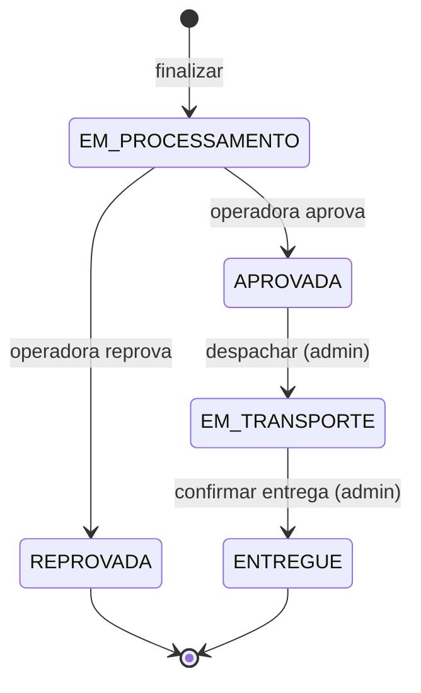
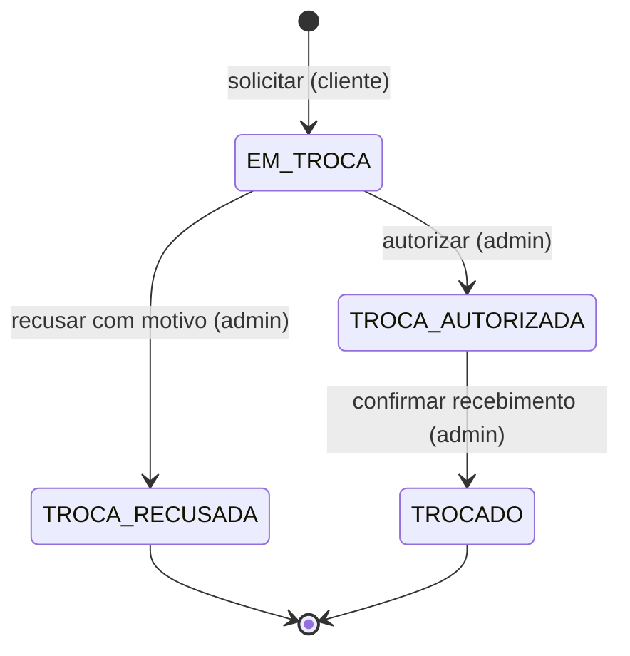

# DEC-12 — Pedido, checkout e trocas

- **Status:** Aceita
- **Escopo:** Negócio
- **Data:** 2026-10-23
- **Card:** #65
- **Requisitos:** RF-VEN-003, RF-VEN-008 a RF-VEN-015, RNF-VEN-001, RN-VEN-002, RN-VEN-008 a RN-VEN-013,
  RN-EST-006, RN-ANA-001, RN-ANA-004, RN-CLI-007

## Contexto

O DRS lista os status do pedido e diz que cada item selecionado para troca gera um "pedido de troca" `EM TROCA`
(RN-VEN-011), mas não diz:

- como o status do pedido convive com o da troca, sobretudo quando só parte dele é trocada;
- se a troca aceita parte da quantidade de um item;
- qual é o prazo para pedir a troca;
- o que acontece se o admin não aceitar a troca;
- o que o pedido copia dos dados que mudam com o tempo;
- se o cliente pode tentar de novo depois de uma reprovação.

Na análise (RN-ANA-004), o DRS cita compras "canceladas", status que não existe.

## Decisão

### Checkout

Entre o carrinho e o pedido existe a **sessão de compra** (`Checkout`). É ela que segura as reservas enquanto o
cliente paga.

- **Início:** em "Ir para pagamento", os itens saem do carrinho e vão para um checkout novo. As reservas passam para
  ele com prazo `livraria.checkout.prazo` (`Duration`, padrão `60m`), contado do início. O carrinho fica vazio e pode
  receber itens novos.
- **Um checkout aberto por cliente.** Iniciar outro com um já aberto responde 409.
- **Voltar ao carrinho:** os itens voltam ao carrinho, somados aos que já estiverem lá, e o bloqueio do carrinho
  recomeça ([DEC-05.1](DEC-05.1-bloqueio-do-carrinho.md)). O checkout é encerrado. Para mudar quantidades, o cliente
  volta ao carrinho.
- **Finalizar:** cada finalização cria um **pedido** `EM PROCESSAMENTO` (RF-VEN-008), com os endereços, os cartões e
  os cupons informados nela. O pedido só existe a partir da finalização.
  - `APROVADA`: as reservas viram baixa de estoque e o checkout é concluído.
  - `REPROVADA`: o pedido fica no histórico, os cupons voltam ([DEC-11](DEC-11-cupons-e-distribuicao-do-pagamento.md))
    e o checkout **continua aberto**, com as mesmas reservas e o mesmo prazo, para outra tentativa.
- **Expiração:** vencido o prazo, as reservas são liberadas e os itens aparecem nos itens removidos do carrinho
  (RNF-VEN-001), com a opção de adicioná-los de novo. O aviso de expiração sai com a antecedência de
  `livraria.checkout.aviso-expiracao` (`Duration`, padrão `5m`), parâmetro próprio do checkout.
- Inativar a conta ([DEC-10](DEC-10-cliente-enderecos-e-cartoes.md)) também encerra o checkout aberto e libera as
  reservas dele.
- Como os itens do checkout estão reservados, o estoque deles não muda até a finalização. A finalização revalida o
  estoque mesmo assim (RN-VEN-002). Itens perdidos por expiração são avisados por notificação
  ([DEC-13](DEC-13-processamento-do-pedido-e-notificacoes.md)).

### Status do pedido

O pedido tem os status do ciclo da venda: `EM PROCESSAMENTO`, `APROVADA`, `REPROVADA`, `EM TRANSPORTE` e
`ENTREGUE`. `REPROVADA` e `ENTREGUE` são finais: **depois de entregue, o status do pedido não muda mais**. Os status
de troca do DRS (`EM TROCA`, `TROCA AUTORIZADA`, `TROCADO`) ficam na troca. Não há status de cancelamento.

Qualquer outra transição é proibida: o `Pedido` a recusa e a API responde 409
([DEC-07](DEC-07-convencoes-da-api-rest.md)). O pedido guarda a data e hora da finalização (`realizadoEm`) e da
entrega (`entregueEm`).

### Cópia no pedido

Tudo o que pode mudar com o tempo é copiado, não referenciado:

| Origem | O pedido guarda |
|---|---|
| Item | referência ao livro, título, autores, editora, edição, ISBN, categorias, preço unitário de venda e quantidade |
| Cliente | referência ao cliente, nome, CPF, e-mail e telefone |
| Endereços | cópia dos endereços de entrega e de cobrança ([DEC-10](DEC-10-cliente-enderecos-e-cartoes.md)) |
| Cartões | bandeira, 4 últimos dígitos e valor pago ([DEC-10](DEC-10-cliente-enderecos-e-cartoes.md)) |
| Cupons | código, categoria, tipo e valor abatido |
| Valores | subtotal dos itens, frete, desconto do promocional e total |

A troca referencia os itens do pedido, que já são cópia, e guarda a quantidade trocada e o valor do cupom gerado.

### Troca

A troca é uma entidade própria (`Troca`) com itens e quantidades. É o "pedido de troca" do RN-VEN-011.

**Status da troca:**

**Solicitação (RF-VEN-011, RN-VEN-013):**

- Só de pedidos `ENTREGUE`, até o fim do dia `entregueEm` + `livraria.troca.prazo` (`Period`, padrão `P7D`).
- O cliente escolhe os itens e a quantidade de cada um (por exemplo, 2 de 3 exemplares).
- Cada item tem uma **quantidade disponível para troca**: a comprada menos a que já está em qualquer troca do
  pedido, inclusive as recusadas. Por isso um item recusado não pode ser pedido de novo.
- Um pedido pode ter várias trocas, enquanto houver quantidade disponível e o prazo não vencer.

**Recusa:** só em `EM TROCA`, com motivo obrigatório, que vai na notificação ao cliente.

**Recebimento (RF-VEN-014, RF-VEN-015, RN-VEN-012):**

- O admin informa, para cada item da troca, se ele volta ao estoque. Se voltar, há reentrada (RF-EST-004).
- A troca passa a `TROCADO` e gera **um cupom de troca** no valor da soma de preço unitário × quantidade dos itens,
  sem frete ([DEC-11](DEC-11-cupons-e-distribuicao-do-pagamento.md)). O cupom é gerado também para itens que não
  voltam ao estoque.

**Indicador no pedido:** o status do pedido continua `ENTREGUE`, e a troca aparece como indicador calculado
`troca`, ausente quando não há nenhuma:

- `situacao`: o status da troca mais recente do pedido, inclusive `TROCA RECUSADA`;
- `abrangencia`: `TOTAL` se as trocas não recusadas cobrirem toda a quantidade do pedido, senão `PARCIAL`.

Cada item do pedido mostra o status da troca mais recente dele, e o detalhe do pedido lista todas as trocas. A
consulta de pedidos do admin filtra por `situacao`.

### Análise e ranking

- **Status considerados:** pedidos `APROVADA`, `EM TRANSPORTE` e `ENTREGUE`, como no RN-ANA-004, tanto na análise
  quanto no ranking ([DEC-04](DEC-04-ranking-de-cliente.md)). O "canceladas" do RN-ANA-004 não corresponde a nenhum
  status.
- **Trocas concluídas descontadas:** a quantidade em trocas `TROCADO` sai da conta. Trocas em andamento ainda não
  descontam.
- **Análise (RN-ANA-001):**
  - Soma, por mês da finalização (`realizadoEm`) e por categoria copiada no pedido, o preço unitário × a quantidade
    não trocada de cada item.
  - Não inclui frete, e o desconto do promocional não é rateado.
  - Um item com várias categorias entra com o valor cheio em cada uma.
- **Ranking:** o valor do pedido é o total menos os cupons gerados pelas trocas concluídas dele.

## Alternativas consideradas

- Pedido criado ao iniciar o pagamento, voltando de `REPROVADA` para `EM PROCESSAMENTO`: o pedido existiria antes
  da finalização (RF-VEN-008), e o abandonado precisaria de um status final.
- Liberar as reservas na reprovação: obriga a remontar o carrinho e pode perder o estoque para outro cliente.
- Reprovação sem criar pedido: o DRS manda o pedido existir como `REPROVADA` (RN-VEN-008).
- Pedido acompanhando o status da troca, como no DRS (RN-VEN-011, RN-VEN-012): exige decidir qual troca muda o
  pedido numa troca parcial, e uma recusa tardia deixaria um pedido `TROCADO` com itens que o cliente manteve.
- Indicador agregado ("em andamento", "concluída", "recusada"): perde o status exato da troca.
- Status por item dentro do pedido: mistura o ciclo da venda com o da troca.
- Indicador de troca gravado no pedido: duplica o que as trocas já dizem.
- Troca sem recusa: o admin não teria como negar uma troca indevida.
- Sem prazo de troca: o pedido nunca encerraria.
- Item que não volta ao estoque sem cupom: o RF-VEN-015 gera o cupom em todo recebimento.
- Status `CANCELADO`: o DRS não tem fluxo de cancelamento, e definir quem cancela, até quando e como o valor volta
  seria escopo sem requisito.
- Valor do item dividido entre as categorias: a linha de uma categoria deixaria de ser "vendas da categoria".

## Consequências

- Desvios do DRS, registrados nas matrizes:
  - na reprovação, os itens só são desbloqueados quando o checkout expira (RN-EST-006);
  - o pedido não passa a `EM TROCA` nem a `TROCADO`; esses status são da troca, que tem também `TROCA RECUSADA`
    (RN-VEN-011, RN-VEN-012);
  - o admin autoriza e consulta **trocas** `EM TROCA`, não compras (RF-VEN-012, RF-VEN-013);
  - o RN-ANA-004 desconta as trocas concluídas e não tem "canceladas".
- O ranking passa a considerar só `APROVADA`, `EM TRANSPORTE` e `ENTREGUE` e a descontar as trocas concluídas (DEC-04).
- Os casos de uso de transição são um por arquivo: `IniciarCheckout`, `VoltarAoCarrinho`, `FinalizarCompra`,
  `DespacharPedido`, `ConfirmarEntrega`, `SolicitarTroca`, `AutorizarTroca`, `RecusarTroca` e
  `ConfirmarRecebimentoDaTroca`.
- `QuantidadeDisponivelParaTroca`, `PrazoDeTroca` (RN-VEN-013) e `IndicadorDeTroca` são regras ou cálculos puros.
- A consulta da análise e o cálculo do ranking somam por item, descontando as trocas concluídas.
