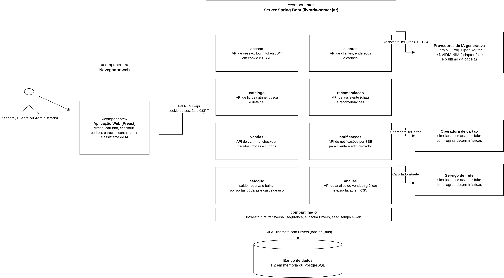
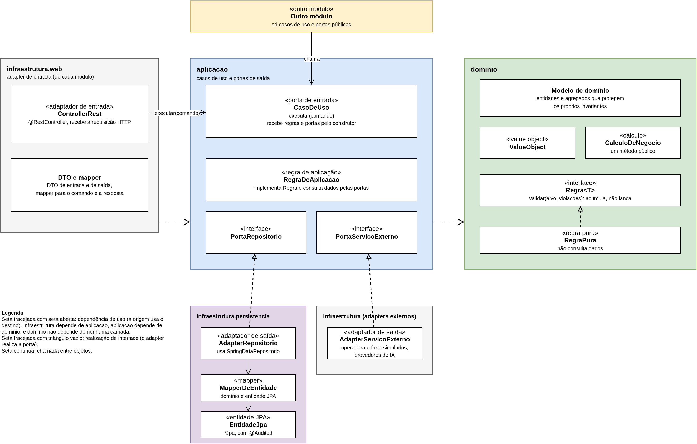

# 7. Representação Arquitetural

O sistema Livraria tem duas aplicações separadas. A aplicação web é uma página de uma só tela (SPA) escrita em Preact com TypeScript. Ela roda no navegador do usuário e pede os dados a um back-end escrito em Java com Spring Boot, que expõe uma API REST. Na demonstração e na entrega, o back-end também entrega a aplicação web: um único processo, na porta 8080, responde tanto às telas quanto à API, na mesma origem. Com isso o navegador não precisa de configuração de endereço da API nem de regras especiais entre sites diferentes (DEC-09). A Figura 7.1 mostra os componentes do sistema e como eles se ligam.

**Figura 7.1 - Diagrama de componentes do sistema**

O back-end é organizado em módulos, um para cada grupo de requisitos do DRS: catálogo de livros, clientes, estoque, vendas, análise, recomendação, acesso e notificações, além de um módulo compartilhado com a infraestrutura comum. Cada módulo segue a arquitetura hexagonal, também chamada de portas e adaptadores. A ideia é separar três partes. O domínio guarda os modelos e as regras de negócio puras, sem depender de banco de dados nem de framework. A aplicação contém os casos de uso, que são as operações que o sistema oferece, e as portas de saída, que são interfaces que descrevem o que o caso de uso precisa de fora, como gravar um pedido ou consultar a operadora de cartão. A infraestrutura contém os adaptadores, que são as implementações concretas dessas interfaces: os controladores REST que recebem as chamadas, a persistência em banco e as conexões com serviços externos. Testes de arquitetura, feitos com a biblioteca ArchUnit, falham a construção do sistema se alguma dependência andar no sentido proibido. Eles verificam, por exemplo, que o domínio não depende de persistência, de aplicação nem de infraestrutura, que a aplicação não depende de infraestrutura e que o módulo compartilhado não depende dos demais. A regra de que um módulo não acessa a persistência de outro, usando apenas os casos de uso e as portas públicas dele, é uma convenção do projeto e não é verificada por teste.

A Figura 7.2 mostra essa organização de forma genérica, válida para qualquer módulo. Uma requisição entra pelo controlador REST, que é um adaptador de entrada: ele lê os dados HTTP, converte-os em um objeto de comando e entrega esse comando ao caso de uso. O caso de uso é a porta de entrada do módulo. Ele executa as regras do domínio sobre os dados e, quando precisa consultar ou gravar algo, chama as portas de saída. Cada regra não lança erro logo na primeira falha. Ela acumula as violações encontradas, e ao final o caso de uso responde com uma única falha de negócio que traz a lista completa. Os adaptadores de persistência e de serviços externos implementam essas portas de saída: o primeiro traduz os modelos do domínio para as entidades do banco e vice-versa, e o segundo fala com os serviços de fora, como a operadora de cartão e o cálculo de frete. Em todo o desenho, as setas de dependência apontam para o domínio. Assim, trocar o banco ou um fornecedor externo não exige mudar as regras de negócio.

**Figura 7.2 - Organização interna de um módulo (arquitetura hexagonal)**

As camadas tradicionais de apresentação, negócio e persistência correspondem às partes reais do sistema assim: a apresentação é formada pelos controladores REST de cada módulo e pela aplicação web; o negócio reúne o domínio e os casos de uso; a persistência é a parte de adaptadores que grava e lê dados no banco.

A autenticação usa uma sessão baseada em token. Ao fazer login, o back-end gera um token JWT, que é uma credencial assinada contendo quem é o usuário e seu papel. O token é validado pelo Spring Security em cada requisição. O navegador não guarda o token em uma variável acessível ao JavaScript: ele vai em um cookie marcado como HttpOnly, que o script da página não consegue ler, e com SameSite=Strict, que impede o navegador de enviá-lo em pedidos disparados por outros sites. Como esse cookie só circula na mesma origem, front-end e back-end precisam ser servidos pelo mesmo processo. Para proteger as escritas contra ataques em que outro site dispara uma ação em nome do usuário (CSRF), o servidor também emite um cookie com um token CSRF, legível pelo JavaScript. A aplicação web lê esse cookie e devolve o mesmo valor em um cabeçalho HTTP em todo pedido de escrita. As rotas se dividem em três níveis: públicas (a vitrine e o autocadastro), de cliente autenticado e de administrador. A cada requisição autenticada, o servidor recarrega o usuário indicado no token e recusa a chamada se ele estiver inativo. Com isso, se um cliente for inativado, o acesso dele deixa de valer na requisição seguinte, sem esperar o token expirar (DEC-08).

O assistente de livros, que faz as recomendações e responde perguntas do cliente, usa IA generativa por meio de uma porta própria, no módulo de recomendação (DEC-03). Como o ambiente de apresentação não roda modelo local, o adaptador chama provedores externos gratuitos que aceitam a mesma interface de programação da OpenAI: Gemini, Groq, OpenRouter e NVIDIA NIM. As chamadas seguem uma cadeia de prioridade. A primeira tentativa vai ao primeiro provedor configurado. Se ele falhar por falta de rede, por cota esgotada, por demora de mais de 20 segundos ou por uma resposta fora do formato esperado, a chamada passa ao próximo. Um provedor que devolve cota esgotada fica fora da cadeia por um tempo. No desenvolvimento e nos testes, quando nenhuma chave está configurada, a cadeia usa um adaptador fake, determinístico e sem rede. Na apresentação, esse adaptador fica inativo: a cadeia usa só os provedores reais, e uma falha de todos eles deixa o assistente indisponível. As respostas do modelo chegam em formato estruturado e validado, e o back-end nunca interpreta texto livre para decidir algo.

A operadora de cartão e o serviço de frete previstos no DRS são simulados. A porta da operadora se chama OperadoraDeCartao, e seu adaptador segue regras fixas. O frete também tem uma porta com um adaptador de regras fixas, de modo que os resultados sejam previsíveis nos testes. A operadora recusa cartão vencido, número que termina em 0000 e código de segurança igual a 000 (DEC-05.2). O frete depende do CEP de entrega e do peso e das dimensões dos livros (DEC-05.3). A finalização da compra acontece em duas gravações separadas. Primeiro o pedido é gravado como EM PROCESSAMENTO. Depois a operadora é consultada, fora de qualquer transação aberta, e o pedido recebe o resultado final, APROVADA ou REPROVADA, em uma segunda gravação. As notificações ao usuário são persistidas no módulo de notificações e enviadas ao navegador por SSE, um canal em que o servidor empurra mensagens pela mesma conexão HTTP. O envio só acontece depois que a gravação foi confirmada, para que o usuário nunca receba aviso de algo que não ficou salvo (DEC-13).

O log de transação, exigido pelo RNF-GER-002, usa a biblioteca Hibernate Envers. As entidades persistidas são marcadas para auditoria, e cada alteração é copiada para uma tabela paralela com o sufixo _aud. Cada revisão guarda o usuário responsável pela escrita e a data e hora. Assim não é preciso escrever um mecanismo de log à mão.

### 7.1. Restrições Arquiteturais

A disciplina impõe poucas restrições de tecnologia, e a maior parte da pilha foi escolhida pela equipe e registrada nas decisões do projeto. A única restrição externa veio do ambiente de apresentação da faculdade, onde a versão do Java disponível é a 21. Por isso o back-end foi fixado nessa versão. Pelo mesmo motivo, a IA generativa não pode depender de modelo rodando na própria máquina, e precisa ser chamada em provedores de internet (DEC-03).

No back-end, a base é Java 21 com Spring Boot 4.1 e Maven. O acesso ao banco usa Spring Data JPA com Hibernate, a segurança usa Spring Security, a auditoria usa Hibernate Envers, e a parte web usa Spring Web. A integração com os provedores de IA usa Spring AI 2.0, com o cliente compatível com a OpenAI. O banco pode ser H2 em memória, que roda dentro do próprio processo, ou PostgreSQL 17, e a escolha é feita por perfil de execução. O schema é gerado pelo próprio ORM, sem ferramenta de migração, e os dados iniciais entram por scripts de carga executados na inicialização. Para converter entre modelos de domínio, entidades e DTOs, o projeto usa MapStruct, e Lombok reduz código repetitivo. O contrato da API é descrito em OpenAPI pelo springdoc, e esse contrato gera os tipos usados pela aplicação web.

No front-end, a base é Preact 11 com TypeScript, empacotada pelo Vite 8. As rotas usam preact-iso, os gráficos da análise de vendas usam uPlot, e as chamadas à API usam openapi-fetch. A lista de dependências é fechada e pequena, para que a instalação funcione com conexão ruim. O estilo é feito em CSS puro e os formulários são os nativos do navegador, sem biblioteca de componentes (DEC-01, DEC-17). Os testes de ponta a ponta usam o Playwright com o Chrome já instalado na máquina, sem baixar navegadores extras (DEC-02). Os testes de unidade, de integração e de arquitetura usam JUnit 5, AssertJ e ArchUnit.

### 7.2. Objetivos e Restrições Arquiteturais

O requisito de recomendação e chatbot com IA generativa (RNF-REC-001) exige conversar com provedores pela internet. As cotas gratuitas são baixas, variam de projeto para projeto e são consumidas a cada chamada. Por isso a arquitetura prevê a cadeia de provedores, com a saída temporária de um provedor que esgotou a cota, o tempo limite de 20 segundos por chamada e um registro de cada tentativa em uma tabela própria, usada nas métricas. Essas medidas evitam que um provedor fora do ar derrube o assistente. Para o cálculo de recomendações, o servidor escolhe os candidatos por regras fixas, sem busca vetorial, porque o catálogo é pequeno (DEC-03).

Os requisitos de pagamento e frete aceitam simulação. A operadora de cartão e o serviço de frete são portas com adaptadores de regras determinísticas (DEC-05.2, DEC-05.3). As regras determinísticas mantêm as aprovações e as recusas previsíveis, e dispensam credenciais de serviços reais.

Três escolhas de segurança vieram diretamente do projeto. As senhas são guardadas com o algoritmo BCrypt, por meio de uma porta própria (RNF-CLI-003). O código de segurança do cartão não é gravado em nenhum lugar: ele circula apenas na chamada à operadora. A sessão em cookie e o token CSRF exigem que front-end e back-end estejam na mesma origem, e o servidor recarrega o usuário do token a cada requisição, o que faz a inativação valer de imediato (DEC-08).

Dois requisitos de qualidade completam o conjunto. O primeiro é o tempo de resposta das consultas, de no máximo 1 segundo (RNF-GER-001). Para cumpri-lo, as listagens são sempre paginadas, com no máximo 100 itens por página, e as colunas usadas em filtros e ordenações têm índice. Os testes medem as consultas principais com a carga inicial completa. O segundo é o log de transação auditável (RNF-GER-002), atendido pelo Envers, como descrito acima. Os valores monetários também restringem a implementação: os cálculos usam um tipo próprio de dinheiro, com decimal exato e duas casas, nunca número de ponto flutuante, que arredonda valores de forma imprecisa (DEC-15.1).
