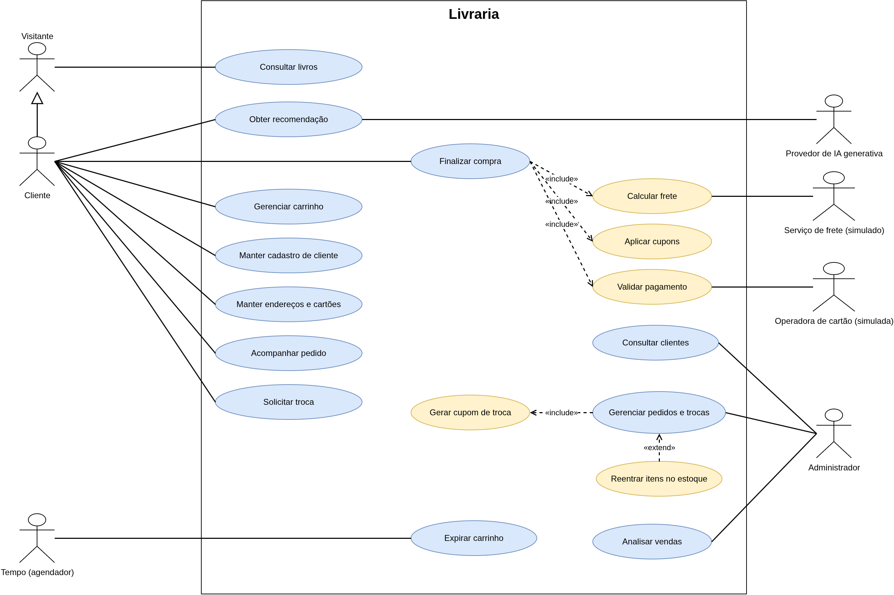

# 8. Visão de Use Case

Nem todo caso de uso pesa nas decisões técnicas. Os que pesam são os que dependem da estrutura do sistema para
acontecer: os que chamam outros casos de uso ou conversam com um sistema externo. A venda de ponta a ponta é o
exemplo mais claro. Finalizar compra calcula o frete, aplica cupons e pede à operadora de cartão, empresa que aprova
ou recusa a cobrança (aqui simulada), a validação do pagamento. Gerenciar pedidos e trocas gera o cupom e, quando um
item volta ao estoque, chama a reentrada dele. Obter recomendação depende por completo da chamada ao provedor de IA
generativa. Os demais casos, centrados em cadastro e consulta, aparecem só no quadro resumo da seção 8.2.

Os casos de escrita do cadastro de livros e a entrada manual de itens em estoque ficam fora do MVP, a versão mínima
que a disciplina exige. Livros e estoque entram por um script SQL de carga inicial, e as consultas e as regras de
preço valem sobre esses dados (seção 4.3.3).

### 8.1. Diagrama de Casos de Uso Geral do Sistema

A Figura 8.1 mostra quem usa o sistema, os atores, e os casos de uso principais, agrupados dentro da fronteira
Livraria, que separa o que é do sistema do que é externo. O Visitante navega pela vitrine. O Cliente é um Visitante
com conta, por isso herda a consulta de livros e ganha casos próprios: carrinho, compra, pedido, troca, cadastro e
recomendação. O Administrador consulta clientes, conduz pedidos e trocas e analisa as vendas. O ator Tempo representa
o agendador do servidor, o mecanismo que executa tarefas em intervalos fixos, como a expiração de carrinhos e de
sessões de compra. Fora da fronteira ficam os três sistemas externos. O serviço de frete e a operadora de cartão são
simulados por regras fixas, sem rede. O provedor de IA generativa é real na apresentação. No desenvolvimento e nos
testes, há uma versão determinística, chamada de adapter fake, que responde sem rede e sem chave.

**Figura 8.1 - Diagrama de casos de uso geral do sistema**

### 8.2. Descrição dos Casos de Uso Arquiteturalmente Significativos

Em Gerenciar carrinho, o cliente logado escolhe um livro na vitrine e o põe no carrinho. O sistema confere se há
exemplares disponíveis, reserva a quantidade pedida e inicia um prazo de trinta minutos, contado a partir do último
item incluído. A reserva existe para que o livro não saia para outro cliente enquanto o primeiro ainda decide. O
prazo existe para que uma reserva abandonada não fique presa para sempre. Trinta minutos foi o valor escolhido
porque quinze seria apertado para uma compra real, e sessenta dificultaria demonstrar a expiração sem mudar a
configuração (DEC-05.1). Dentro do carrinho, o cliente altera quantidades ou exclui itens, e o sistema recalcula os
totais e mantém a reserva. Itens com prazo vencido continuam listados, com a compra desabilitada e a opção de
colocá-los de novo no carrinho (RF-VEN-001, RF-VEN-002, RNF-VEN-001).

O caso Expirar carrinho não é iniciado por nenhum usuário. O próprio servidor, pelo ator Tempo, o executa a cada
trinta segundos, como tarefa agendada. Em cada rodada, ele confere as reservas vencidas, avisa o cliente quando faltam
cinco minutos (antecedência fixada pelo DRS) e, no vencimento, libera as reservas, tira do carrinho os itens do
produto expirado e os passa para a lista de itens removidos, notificando o cliente. Todas as unidades do produto saem
do carrinho, e não só uma parte, porque o carrinho guarda um único registro por livro (RN-VEN-015). A mesma tarefa
encerra as sessões de compra vencidas, devolvendo as reservas das tentativas que não foram concluídas (RN-VEN-014,
DEC-05.1, DEC-13).

Em Finalizar compra, o caso mais carregado do sistema, o cliente sai do carrinho para pagar. Os itens e as reservas
passam para uma sessão de compra nova, chamada de checkout, com prazo próprio de sessenta minutos. Só pode haver uma
sessão aberta por cliente. A sessão existe para segurar as reservas enquanto o cliente paga, e, nesse período, o
carrinho fica livre para receber outros itens.

O pagamento tem quatro passos. Primeiro, o cliente escolhe os endereços de entrega e de cobrança, e o frete é
calculado pelo serviço simulado a partir do CEP e do peso. Depois, aplica os cupons: um cupom promocional, dado pela
loja, e os cupons de troca que ele tiver. Em seguida, divide o valor restante entre os cartões, sendo que cada cartão
precisa pagar ao menos dez reais, regra do DRS. O código de segurança do cartão é pedido a cada compra e nunca fica
gravado. Por fim, o cliente revisa tudo. Um cupom promocional vale uma vez por compra. Se algum cupom for
desnecessário, isto é, se os demais já cobrem o total sem ele, a compra é recusada e o sistema indica qual cupom
retirar. Não há retirada automática porque o cliente precisa saber o que foi descartado. Sem essa recusa, um cupom de
troca sobrando seria convertido em troco que ninguém pediu (DEC-11).

Ao confirmar, o sistema usa duas gravações no banco, chamadas de transações. Cada uma é confirmada ou desfeita por
inteiro. Na primeira, grava o pedido como EM PROCESSAMENTO, copia os dados da compra e marca os cupons como usados.
Só depois consulta a operadora, fora dessa gravação, com o número do cartão e o código de segurança apenas na memória.
Esse desenho tem três razões. O pedido passa a existir no histórico antes da resposta da operadora, e o registro de
transações mostra as duas mudanças de estado, pendente e depois aprovada ou reprovada, o que a auditoria exige
(RNF-GER-002). O número e o código nunca são gravados, o que evita guardar dado sensível sem necessidade. E, se a
segunda gravação falhar por erro técnico, o pedido fica EM PROCESSAMENTO até a sessão expirar, quando é reprovado,
porque sem o número e o código do cartão não há como concluir a cobrança. Na segunda gravação, a operadora aprovando,
o sistema dá baixa no estoque usando as reservas e, se os cupons superarem o total, gera um cupom de troca com o
troco. Se a operadora reprovar, devolve os cupons e mantém a sessão aberta para nova tentativa, até o prazo acabar
(RF-VEN-003, RF-VEN-005 a RF-VEN-008, DEC-11 a DEC-13).

Em Solicitar troca, feito no detalhe de um pedido em Meus pedidos, o cliente escolhe itens e quantidades de um pedido
já entregue, dentro de sete dias contados da data de entrega. Cada item tem uma quantidade disponível para troca, que
é a comprada menos a que já está em outra troca do mesmo pedido, inclusive as recusadas. Assim, um exemplar não pode
ser trocado duas vezes. O sistema cria a troca com a situação EM TROCA e avisa os administradores. O pedido continua
ENTREGUE. A troca é um registro separado, porque, com várias trocas parciais no mesmo pedido, não há um único status
do pedido que represente todas (RF-VEN-011, DEC-12).

Em Gerenciar pedidos e trocas, o administrador lista os pedidos com filtros combinados. Ele despacha um pedido aprovado,
que passa a EM TRANSPORTE, e confirma a entrega, o que marca o início do prazo de troca. Na lista de trocas EM TROCA,
autoriza a troca, avisando o cliente, ou recusa informando um motivo obrigatório. Ao confirmar o recebimento, marca
item a item se o produto volta ao estoque, e, quando volta, o sistema dá entrada dele de novo. A troca fica TROCADO e
gera um cupom de troca no valor dos itens, sem frete, com ou sem retorno ao estoque. O cupom é gerado também para
itens que não voltam, porque a regra do DRS vale para todo recebimento (RF-VEN-009, RF-VEN-010, RF-VEN-012 a
RF-VEN-015, RF-EST-003, RF-EST-004, DEC-12).

A troca devolve um cupom, e não dinheiro, porque os requisitos não preveem devolução em dinheiro e o DRS define o cupom
de troca como o crédito para compras futuras (RF-VEN-015). O valor continua na loja, e o cupom só vale para o cliente
que trocou. Ele é usado inteiro numa única compra e, se custar mais do que a compra, o excedente vira troco em outro
cupom de troca (DEC-11).

Em Analisar vendas, o administrador escolhe um período de até vinte e quatro meses e uma categoria, ou todas. O
sistema soma o valor vendido, mês a mês e por categoria. Os valores vêm das cópias guardadas nos pedidos, e não dos
livros atuais, para que uma mudança de preço ou de categoria depois da compra não altere o passado. Entram os pedidos
aprovados, em transporte ou entregues. O DRS cita também pedidos "cancelados", mas o projeto não tem esse status, e
esses três estados são os das vendas efetivamente concluídas. Das quantidades, descontam-se as trocas já concluídas,
porque o cliente devolveu o item e recebeu cupom por ele. Trocas em andamento ainda não descontam. Frete e desconto
do cupom promocional ficam de fora. O resultado aparece em gráfico, com a tabela dos valores, e pode ser exportado
como planilha CSV, um arquivo de texto com colunas separadas por ponto e vírgula, formatado para abrir direto no Excel
em português (RF-ANA-001 a RF-ANA-004, RN-ANA-001 a RN-ANA-004, DEC-12, DEC-15.4).

Em Obter recomendação, o cliente vê sugestões na vitrine, na seção de recomendados, ou conversa com o chatbot do
assistente. Por trás disso há um modelo de IA generativa, um serviço externo que escreve texto. O sistema não treina
esse modelo, porque treinar ou ajustar um modelo gratuito não é viável. Em vez disso, a cada chamada envia o contexto:
o perfil do cliente, com livros comprados, categorias e autores mais frequentes e avaliações anteriores, e um conjunto
pequeno de candidatos, escolhidos por pontuação simples, como categorias e autores em comum e livros comprados juntos
por outros clientes. A personalização acompanha as compras e as avaliações sem mudar o modelo. Como o catálogo tem
apenas vinte livros, não se usa busca por semelhança de textos.

O pedido vai ao primeiro provedor da cadeia que tenha chave configurada. Os provedores gratuitos têm cota baixa, que
pode acabar durante a apresentação, então, quando um falha, a chamada segue para o próximo. Por último, quando o
profile de desenvolvimento está ativo, fica o provedor fake, que responde sempre igual e sem rede. Ele atende os
testes automatizados, que não podem depender de rede nem de chave, e fica inativo na apresentação. Se todos os
provedores ativos falharem, o assistente informa que está indisponível. A resposta volta em formato estruturado,
validado, e o servidor confere os livros
citados contra o catálogo e o estoque, retirando os que não existem ou não podem ser vendidos. A IA não executa ações:
adicionar ao carrinho é um botão da tela, sob controle do cliente. O cliente avalia cada resposta, e essas avaliações
entram no perfil. Cada tentativa de chamada é registrada com tempo de resposta e resultado, e as métricas dessas chamadas aparecem na
aba Assistente da área do administrador, junto da configuração da cadeia de provedores (RNF-REC-001, DEC-03).

O quadro resumo relaciona os casos de uso principais, os atores e os requisitos de origem. Os casos discutidos acima
ganham detalhamento também nas especificações de caso de uso do fluxo de Gestão de Vendas.

| Caso de uso | Atores | Requisitos |
| - | - | - |
| Manter cadastro de cliente | Cliente | RF-CLI-001 a RF-CLI-003, RF-CLI-005, RF-CLI-008; RNF-CLI-001 a RNF-CLI-003, RNF-CLI-005 |
| Manter endereços e cartões | Cliente | RF-CLI-006, RF-CLI-007; RNF-CLI-004; DEC-10; DEC-18 |
| Consultar livros | Visitante e Cliente | RF-LIV-005 |
| Gerenciar carrinho | Cliente | RF-VEN-001, RF-VEN-002; RN-VEN-001 |
| Finalizar compra | Cliente | RF-VEN-003, RF-VEN-005 a RF-VEN-008; RN-VEN-002 a RN-VEN-008; DEC-11 a DEC-13 |
| Acompanhar pedido | Cliente | RF-VEN-009, RF-VEN-010; RN-VEN-008 a RN-VEN-010; DEC-12; DEC-13 |
| Solicitar troca | Cliente | RF-VEN-011; RN-VEN-011, RN-VEN-013; DEC-12 |
| Gerenciar pedidos e trocas | Administrador | RF-VEN-009, RF-VEN-010, RF-VEN-012 a RF-VEN-015; RN-VEN-008 a RN-VEN-012, RN-VEN-016; RF-EST-003, RF-EST-004; DEC-12 |
| Consultar clientes | Administrador | RF-CLI-004, RF-CLI-005 |
| Analisar vendas | Administrador | RF-ANA-001 a RF-ANA-004; RNF-ANA-001; RN-ANA-001 a RN-ANA-004; DEC-15.4 |
| Obter recomendação | Cliente | RNF-REC-001; DEC-03 |
| Expirar carrinho | Tempo (agendador) | RNF-VEN-001; RN-VEN-014, RN-VEN-015; DEC-05.1; DEC-13 |
