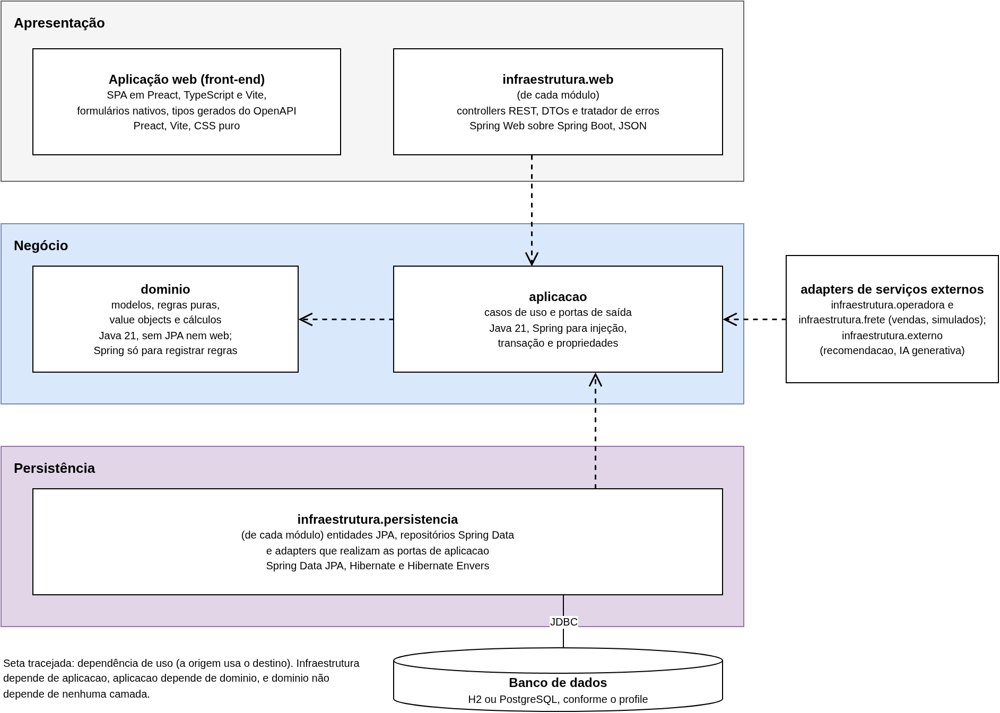
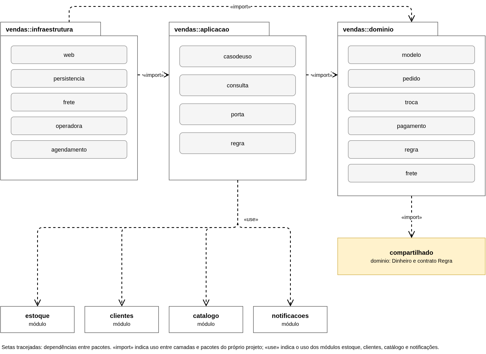
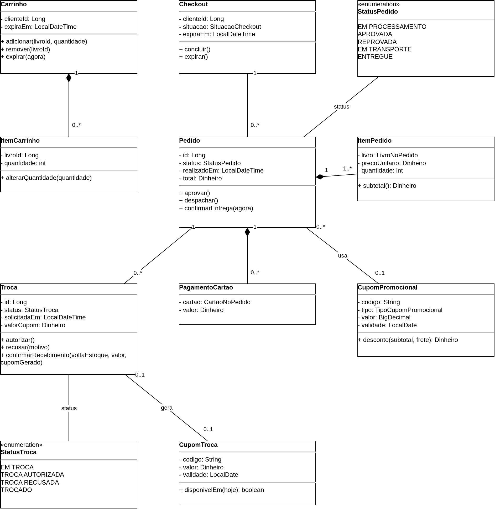
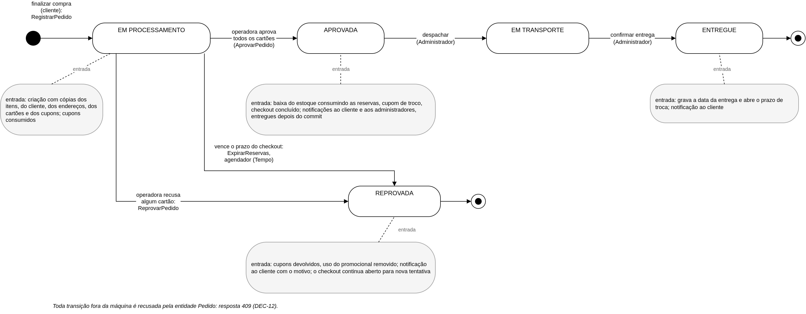
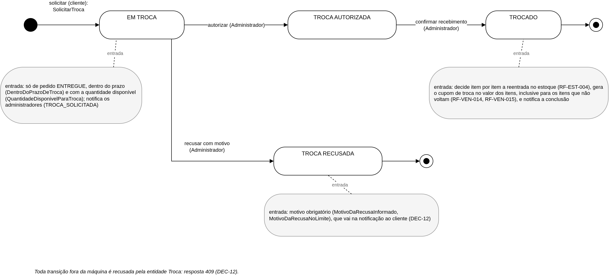
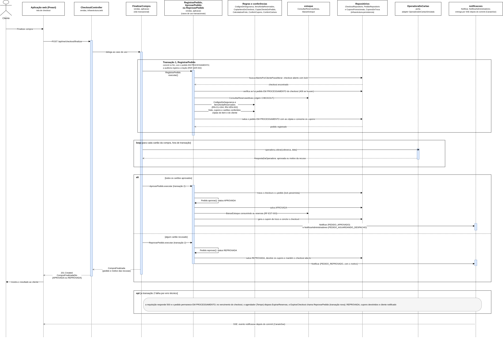

# 9. Visão de Lógica

O servidor é organizado em módulos, um para cada grupo de requisitos do DRS: clientes, catálogo, estoque, vendas, análise, recomendação e os demais. Cada módulo se divide em três partes, que seguem a arquitetura hexagonal: domínio (as regras e os modelos do negócio), aplicação (os casos de uso, ou seja, as operações que o sistema executa, e as portas, que são as interfaces pelas quais a aplicação conversa com o mundo de fora) e infraestrutura (as classes que implementam essas portas e recebem as requisições, como a API e o banco de dados). A aplicação web, que roda no navegador, segue a mesma lógica, com pastas por funcionalidade que espelham os módulos do servidor (DEC-17). Como todos os módulos têm a mesma forma, esta visão detalha um deles, o módulo vendas, que concentra o caso de uso mais complexo do MVP, a finalização da compra (DEC-12). A Figura 9.1 mostra as três camadas do DVP e como elas correspondem à estrutura do projeto.

**Figura 9.1 - Diagrama de camadas do sistema**

O mapeamento entre as camadas do DVP e a arquitetura é direto. A Apresentação corresponde à parte de entrada web de cada módulo e à aplicação web. O Negócio reúne o domínio e a aplicação. A Persistência corresponde à parte da infraestrutura que fala com o banco. No servidor, a Apresentação usa Spring Web sobre Spring Boot e troca dados em JSON. A aplicação web é escrita em Preact com TypeScript, Vite e CSS puro, sem biblioteca de componentes (DEC-01). O domínio e a aplicação são escritos em Java 21. O Spring entra nesse trecho só para injeção de dependência, que é a entrega automática das classes de que cada uma precisa, e para marcar as transações, o que deixa as regras fáceis de testar sem subir o Spring. A Persistência usa Spring Data JPA, que liga objetos Java a tabelas, com Hibernate por baixo e Hibernate Envers para a auditoria, sobre PostgreSQL ou H2, conforme o perfil de execução.

As dependências seguem um sentido só, de fora para dentro. A infraestrutura depende da aplicação, a aplicação depende do domínio, e o domínio não depende de JPA, da aplicação nem da infraestrutura. Um teste de arquitetura com ArchUnit reprova o build se alguma dessas regras for quebrada. Há um detalhe importante na direção do acesso aos dados. O negócio não chama a persistência diretamente. A aplicação declara as portas de saída que precisa, como repositórios e serviços externos, e a persistência implementa essas portas. O caso de uso recebe as implementações prontas. Essa inversão é o que permite trocar a operadora de cartão e o serviço de frete por versões simuladas (DEC-05.2, DEC-05.3).

Na Apresentação, a aplicação web desenha as telas no navegador e valida os formulários antes de enviar qualquer dado, com campos obrigatórios, máscaras de CPF, CEP e cartão e conferência de senha. Ela chama a API com um cliente HTTP tipado. Os tipos são gerados a partir do contrato da API, e o contrato é regenerado a cada mudança (DEC-07). Os avisos de expiração do carrinho e do checkout chegam por SSE, um canal em que o servidor envia eventos a uma tela aberta (DEC-13). No servidor, os controladores REST recebem as requisições em JSON, chamam os casos de uso e devolvem respostas em objetos de transferência. O servidor não monta nenhuma página.

### 9.1. Camada de Apresentação

Cada módulo do servidor tem uma parte de entrada web, com seus controladores e os objetos que trafegam em JSON. No módulo vendas, o controlador do checkout recebe a finalização da compra, e os demais atendem o carrinho, os cupons, os pedidos do cliente e as ações do administrador sobre pedidos e trocas. Os controladores são finos. Eles convertem a entrada em um comando, chamam o caso de uso ou a consulta e devolvem a resposta, sem aplicar regra de negócio. Quando uma regra falha, a exceção de negócio sobe até um tratador global, que responde com o código 422 e uma lista completa das violações. Cada violação traz o código do requisito e a mensagem (DEC-07). Os controladores não acessam as tabelas nem as classes de persistência do módulo.

Do lado do cliente, a aplicação web é dividida em módulos por funcionalidade: sessão, catálogo, carrinho, checkout, conta, pedidos, notificações, administração e assistente (DEC-17). Cada módulo tem pastas com papéis fixos. Há telas, componentes de uso interno, funções puras de validação e cálculo, cada uma com seu teste, hooks para as telas com muito estado e um ponto único de exportação. Um teste de arquitetura próprio confere que os componentes de tela não chamam a API diretamente e que um módulo só usa outro pelo ponto de exportação dele.

### 9.2. Camada de Negócio

O pacote de domínio guarda os modelos, os valores, as regras puras e os cálculos. Os modelos protegem as próprias transições. Um pedido recusa uma mudança de status fora da ordem prevista, mesmo que um caso de uso tente fazê-la. O valor monetário, chamado Dinheiro, é compartilhado por todo o sistema. Ele tem duas casas decimais exatas e arredondamento para cima no meio, aplicado só no fim de cada cálculo (DEC-15.1). Além disso, o pedido não aponta para o livro, o cliente ou o cartão originais. Ele guarda cópias imutáveis desses dados, que registram, por exemplo, o título e os autores do livro, o nome do cliente e apenas a bandeira e os quatro últimos dígitos do cartão (DEC-10, DEC-16).

As regras puras implementam um contrato comum, chamado Regra. Cada regra recebe o objeto a ser validado e acumula as violações encontradas, sem lançar exceção. A Figura 9.2 mostra esse contrato junto com o Dinheiro, na parte compartilhada que o domínio de vendas usa.

O pacote de aplicação concentra os casos de uso e as portas. Cada caso de uso é uma classe com um método que executa a operação e recebe um comando, que é o conjunto de dados que a operação precisa. Há um caso de uso para cada operação e para cada transição de status. Cada um recebe pelo construtor exatamente as regras que aplica, aplica todas e, se alguma falhar, lança uma única exceção de negócio com todas as violações. A transação é marcada no próprio caso de uso. As portas de saída são interfaces que descrevem o que a aplicação precisa de fora, como repositórios e serviços externos.

Entre módulos, a comunicação é sempre pelos casos de uso e portas públicos do outro módulo. Por exemplo, vendas usa o estoque para reservar e dar baixa nas unidades (RF-EST-003, RN-EST-006) e consulta o catálogo para saber se o livro está ativo e com o preço de venda calculado (RF-EST-002, RN-EST-002). Não é o teste de arquitetura que impede um módulo de acessar a persistência de outro, e sim uma convenção do projeto, registrada no documento de arquitetura. A Figura 9.2 mostra os pacotes do módulo vendas e as dependências entre eles.

**Figura 9.2 - Diagrama de pacotes do módulo vendas**

No diagrama, o domínio usa os valores e o contrato de regras da parte compartilhada. A aplicação usa o domínio. A infraestrutura usa a aplicação e o domínio. Os adaptadores de persistência implementam as portas de repositório, os adaptadores de operadora e de frete implementam as portas de serviços externos, o agendamento dispara as tarefas por tempo, e a parte web chama os casos de uso. Um adaptador é a classe que implementa uma porta com uma tecnologia concreta.

#### 9.2.1. Pacote de Aplicação

Os casos de uso do fluxo de compra são os que tratam do carrinho e do checkout, até a finalização da compra, que é descrita na seção 9.4. O ciclo do pedido tem quatro etapas. Primeiro, registrar o pedido, na primeira transação da finalização. Depois, aprovar ou reprovar, na segunda transação, conforme o resultado da operadora (DEC-13). Por fim, despachar e confirmar a entrega, ações do administrador. As trocas são solicitadas pelo cliente e depois autorizadas, recusadas ou concluídas pelo administrador. Ao confirmar o recebimento de uma troca, o sistema devolve os itens ao estoque quando é o caso e gera o cupom de troca (RF-VEN-014, RF-VEN-015).

Um agendador, chamado de Tempo na figura, executa a tarefa ExpirarReservas a cada 30 segundos. Ela dispara os avisos antes do vencimento e, quando o prazo vence, expira o carrinho ou o checkout. Expirar o checkout reprova o pedido que ainda estiver em processamento, usando o mesmo caso de uso de reprovação (RN-VEN-014, RN-VEN-015). Quando o checkout expira, o caso de uso ExpirarCheckout o trata como reprovação pendente, pelo mesmo caminho de ReprovarPedido.

As portas declaram o que o módulo precisa de fora. Para a persistência, há repositórios do carrinho, do checkout, dos pedidos, das trocas e dos cupons. Para os serviços externos, há a operadora de cartão (OperadoraDeCartao) e a calculadora de frete (CalculadoraFrete). Esses dois serviços são simulados com regras determinísticas, ou seja, o mesmo dado sempre dá o mesmo resultado (DEC-05.2, DEC-05.3). Os comandos de entrada são registros simples, sem lógica.

#### 9.2.2. Pacote de Domínio

O domínio do módulo vendas reúne quatro grupos de modelos: as sessões de compra, o pedido, a troca e os cupons. A Figura 9.3 mostra as classes principais de cada grupo, com os atributos e as operações mais importantes.

**Figura 9.3 - Diagrama de classes do módulo vendas**

O carrinho tem zero ou mais itens, um por livro, e vence por prazo. O checkout guarda os itens levados do carrinho e pode gerar zero ou mais pedidos. Um checkout reprovado continua aberto para nova tentativa até expirar (DEC-12). O pedido tem pelo menos um item, zero ou mais pagamentos em cartão (nenhum quando os cupons cobrem o total) e zero ou mais cupons. Um pedido entregue pode ter zero ou mais trocas. Cada troca nasce com os itens informados e pode ser autorizada, recusada com motivo ou concluída. Ao ser concluída, ela gera um cupom de troca no valor dos itens trocados, que o cliente usa em outra compra (DEC-11).

#### 9.2.3. Estados de Pedido e Troca

O ciclo do pedido e o ciclo da troca ficam em entidades separadas. Essa é a decisão central desta parte. O pedido guarda o status da venda, e a troca guarda o status da devolução (DEC-12). A separação resolve um problema que o DRS deixa em aberto. Uma troca pode cobrir só parte dos itens, e um pedido pode ter mais de uma troca. Se o status do pedido acompanhasse a troca, seria preciso decidir qual troca muda o pedido. Uma recusa tardia deixaria o pedido marcado como trocado, com itens que o cliente de fato ficou. Por isso o pedido continua ENTREGUE, e a troca aparece nele apenas como indicador calculado a partir das trocas. O DRS fala em status EM TROCA para o pedido, e este projeto não segue essa leitura pelo motivo acima (RN-VEN-011, RN-VEN-012). Também não existe status de cancelamento, porque o DRS não descreve um fluxo de cancelamento, e criar um seria escopo sem requisito (DEC-12).

Cada entidade protege a própria máquina de estados. Os métodos que mudam o status do pedido e as exigências da troca só aceitam o status de origem previsto. Uma transição fora dessa máquina responde com o código 409, que indica conflito com o estado atual (DEC-12, DEC-07). A Figura 9.4 mostra a máquina do pedido, e a Figura 9.5, a da troca.

**Figura 9.4 - Máquina de estados do Pedido (StatusPedido)**

O pedido nasce EM PROCESSAMENTO na finalização. O caso de uso RegistrarPedido grava o pedido com esse status e confirma a primeira transação antes de qualquer contato com a operadora (DEC-13). Depois disso, o resultado da cobrança decide o próximo estado. Se todos os cartões forem aprovados, AprovarPedido leva o pedido a APROVADA. Nesse momento o estoque é baixado consumindo as reservas, o troco da compra vira cupom de troca, o checkout é concluído e o cliente e os administradores são avisados. Se a operadora recusar algum cartão, ReprovarPedido leva o pedido a REPROVADA, devolve os cupons usados e deixa o checkout aberto para outra tentativa (RN-VEN-008). Cada transição fica registrada em uma revisão própria da auditoria, e as duas aparecem no log (RNF-GER-002).

Um pedido também pode ficar EM PROCESSAMENTO sem desfecho. Se a segunda transação falhar por erro técnico, o pedido permanece nesse status e não pode mais ser aprovado, porque o número e o código de segurança dos cartões existiam só durante a requisição e não são gravados. Quando o prazo do checkout vence, o agendador reprova o pedido pendente e devolve os cupons (DEC-13).

Depois de aprovado, o pedido segue as ações do administrador. DespacharPedido o leva a EM TRANSPORTE. ConfirmarEntrega o leva a ENTREGUE, grava a data e a hora da entrega e abre o prazo de troca. O cliente é avisado em cada uma dessas etapas. REPROVADA e ENTREGUE são estados finais, e a troca feita depois da entrega não muda o status do pedido (DEC-12).

**Figura 9.5 - Máquina de estados da Troca (StatusTroca)**

A troca nasce EM TROCA quando o cliente pede a devolução de itens de um pedido ENTREGUE, dentro do prazo, que é de sete dias depois da entrega por padrão e pode ser configurado. A regra DentroDoPrazoDeTroca confere o prazo, e QuantidadeDisponivelParaTroca confere a quantidade de cada item. A quantidade disponível é a comprada menos a que já foi pedida em outras trocas do mesmo pedido, inclusive as recusadas. Os administradores são avisados de cada troca nova (RN-VEN-011, RN-VEN-013). Quando o administrador autoriza, a troca vai a TROCA AUTORIZADA, e o cliente recebe a notificação de autorização (RN-VEN-016). Quando recusa, a troca vai a TROCA RECUSADA. A recusa exige um motivo, validado pelas regras MotivoDaRecusaInformado e MotivoDaRecusaNoLimite, e o motivo segue na notificação ao cliente. Essa exigência é uma extensão do DRS e não tem identificador próprio (DEC-12).

Na confirmação do recebimento, o administrador informa, item por item, se o livro volta ao estoque. Quando volta, há reentrada no estoque (RF-EST-004). A troca vai a TROCADO e gera um cupom de troca pelo valor dos itens, inclusive dos que não voltaram ao estoque (RF-VEN-014, RF-VEN-015). TROCA RECUSADA e TROCADO são estados finais. O status do pedido continua ENTREGUE, e o pedido só mostra a troca como indicador calculado.

### 9.3. Camada de Persistência

A persistência usa Spring Data JPA sobre Hibernate, com PostgreSQL ou H2 conforme o perfil. O esquema das tabelas é gerado pelo próprio ORM, a ferramenta que converte objetos em tabelas, e não existem scripts de migração. Os dados iniciais vêm de scripts executados na inicialização, depois da criação das tabelas. Esses scripts também carregam as tabelas de domínio que o DRS exige, como autores e editoras (RNF-LIV-002).

A parte de persistência de cada módulo contém as entidades JPA e os adaptadores que implementam as portas de repositório. Cada entidade JPA é separada do modelo de domínio. Um pedido em JPA nunca é usado como modelo de negócio. No módulo vendas, a conversão entre a entidade e o modelo é feita à mão, no próprio adaptador, e o teste de arquitetura impede o domínio de importar classes do JPA. Essa separação é o que mantém a arquitetura estrita. O domínio descreve o que é um pedido, e a persistência descreve como ele vira tabela.

Entre módulos, não existe chave estrangeira nem associação JPA. Uma coluna que aponta para outro módulo guarda só o id do objeto (DEC-16). Dentro do próprio módulo, as referências são chaves estrangeiras normais. Cada entidade tem sua sequência de ids, e os ids do seed ficam em uma faixa separada dos gerados (DEC-14). Os índices exigidos pelos filtros e pelas ordenações são declarados na anotação de cada tabela (RNF-GER-001).

As cópias feitas pelo pedido, como os dados do cliente e os endereços, são snapshots. Essa escolha é explicada na seção 9.4, junto da finalização, porque é lá que a cópia é criada.

A auditoria usa Hibernate Envers (RNF-GER-002). As entidades que são gravadas pelo sistema têm a anotação de auditoria. Cada alteração gera uma revisão em tabelas paralelas, com o sufixo _aud. A revisão guarda o responsável, obtido por uma porta da parte compartilhada, e a data e a hora. Com isso, a linha do tempo de um pedido e as transições de status registradas pela finalização podem ser reconstruídas depois (DEC-13).

### 9.4. Realização dos Casos de Uso Significativos

A finalização da compra atravessa as três camadas. Na Apresentação estão a tela de checkout da aplicação web e o controlador que recebe a requisição. No Negócio estão o caso de uso que coordena a finalização e os casos de uso transacionais. A Persistência guarda o checkout, o pedido e os cupons. A Figura 9.6 acompanha uma finalização real, do clique do cliente até a resposta (RF-VEN-008, DEC-13).

**Figura 9.6 - Diagrama de sequência de Finalizar compra**

O navegador envia a finalização para o endpoint POST /api/me/checkout/finalizar, e o controlador do checkout a repassa ao caso de uso FinalizarCompra. A resposta volta como CompraFinalizadaDto, com o pedido já no status final. O caso de uso FinalizarCompra não é transacional. Ele coordena três passos, e os dois primeiros usam transações separadas com a operadora no meio.

No primeiro passo, RegistrarPedido trava o checkout aberto do cliente e confere se ele já não tem um pedido em processamento. Se tiver, a resposta é 409. Depois confere as reservas, os códigos de segurança e o pagamento. Os códigos de segurança são conferidos pela regra CodigosDeSeguranca (RN-CLI-004), e as reservas, pela regra ItensAindaReservados (RN-VEN-002). O frete é calculado pela calculadora de frete (RF-VEN-004), e os cupons e os cartões são conferidos pelas regras de RF-VEN-007 e RF-VEN-006. Em seguida, o caso de uso cria o pedido EM PROCESSAMENTO com cópias do livro e do cliente, marca os cupons como usados e confirma a transação. A confirmação é o commit, o momento em que a gravação passa a valer no banco. Esse commit também é registrado na auditoria (RNF-GER-002).

No segundo passo, fora de transação, o caso de uso envia cada cobrança à operadora de cartão. A porta OperadoraDeCartao é implementada pelo adaptador simulado OperadoraDeCartaoSimulada, e cada cartão recebe uma RespostaDaOperadora, que diz se foi aprovado ou traz o motivo da recusa. Essa etapa fica fora da transação por um motivo concreto. O número completo e o código de segurança do cartão existem só em memória, durante a requisição, e não são gravados. A cobrança precisa acontecer na mesma requisição. Gravar o pedido antes garante que o registro EM PROCESSAMENTO existe e entra na auditoria. A decisão registrada no projeto não discute a alternativa de manter uma transação aberta durante a cobrança.

No terceiro passo, a segunda transação registra o desfecho. Se todos os cartões forem aprovados, AprovarPedido trava o checkout e o pedido, grava APROVADA, dá baixa no estoque consumindo as reservas, gera o cupom de troco, conclui o checkout e avisa o cliente e os administradores. Para isso, o caso de uso chama os casos de uso públicos Notificar e NotificarAdministradores, do módulo de notificações. Se algum cartão for recusado, ReprovarPedido grava REPROVADA, devolve os cupons e avisa o cliente com o motivo. As notificações são gravadas dentro da transação e só saem para a tela depois do commit, pelo canal SSE. A resposta da requisição já traz o pedido no status final (DEC-13).

O duplo clique em "Finalizar compra" não cria dois pedidos. O botão fica desabilitado durante o envio. No servidor, a segunda finalização encontra um pedido em processamento para o mesmo checkout e recebe 409. Se a segunda transação falhar, a requisição responde com erro 500 e o pedido fica EM PROCESSAMENTO, como descrito acima. Nesse caso, o agendador reprova o pedido quando o checkout expira e devolve os cupons (DEC-13).
