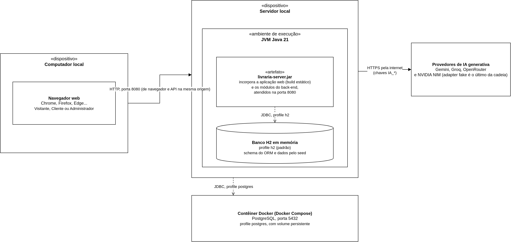

# 10. Visão de Implantação

O MVP não tem ambiente de produção. O sistema é executado localmente, em um único computador de demonstração, com a aplicação e o banco de dados na mesma máquina. A Figura 10.1 mostra os nós dessa execução.

**Figura 10.1 - Diagrama de implantação**

A implantação envolve quatro elementos:

- o computador local, com um navegador moderno, usado pelo visitante, pelo cliente ou pelo administrador (os testes de ponta a ponta usam o Chrome);
- o servidor local, com uma máquina virtual Java 21, que executa o arquivo livraria-server-<versão>.jar na porta 8080;
- o banco de dados, que pode ser o H2, um banco que roda dentro da própria aplicação e some ao ser encerrado, ou um PostgreSQL 17 em um contêiner Docker, na porta 5432;
- os provedores de IA generativa, na internet, acessados por HTTPS.

Na demonstração, a aplicação roda com um único comando, java -jar. O arquivo traz dentro de si a aplicação web já compilada, junto com o back-end. Assim, o navegador acessa tanto as telas quanto a API pelo mesmo endereço, na porta 8080 (DEC-09). A escolha do banco é feita por perfil de execução. Com o H2, não é preciso instalar nada, e o banco é recriado a cada execução, com a estrutura gerada pelo ORM e os dados vindos dos scripts de carga inicial. Com o PostgreSQL, o Docker Compose sobe o contêiner, e a aplicação se conecta a ele pela porta 5432. Os dados ficam em um volume do contêiner e se mantêm entre execuções. A demonstração pode usar qualquer um dos dois bancos.

A comunicação do computador local com o servidor é feita por HTTP na porta 8080. A única conexão que sai da máquina é a dos provedores de IA. Ela usa HTTPS, a chave de cada provedor é lida de variável de ambiente, e cada chamada tem tempo limite de 20 segundos (DEC-03). Se nenhuma chave estiver configurada, a IA usa só o adaptador fake, e nenhum dado sai da rede local.

No desenvolvimento, a diferença é pequena. O back-end roda na porta 8080 com o H2, e um servidor de desenvolvimento do front-end roda na porta 5173. Esse servidor repassa as chamadas à API para o back-end, de modo que o navegador continua falando com uma única origem (DEC-09).
