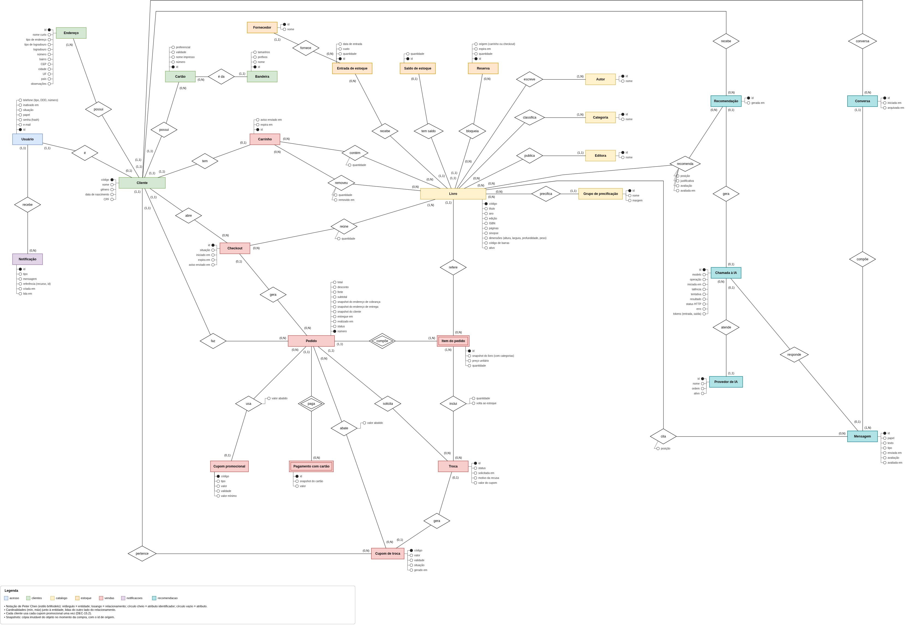
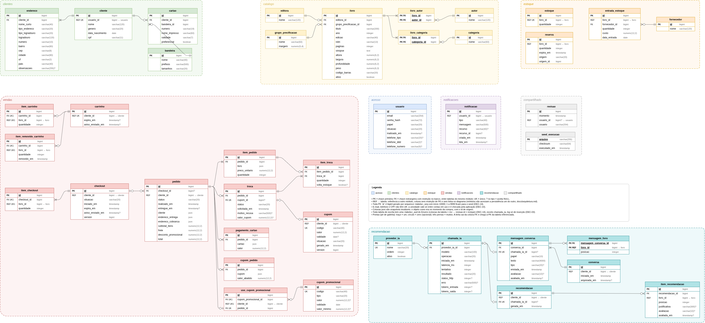

# 12. Visão de Dados

O sistema guarda seus dados em um banco relacional, que organiza a informação em tabelas ligadas entre si por chaves. Há dois bancos, e o perfil de execução (o conjunto de configurações com que o sistema sobe) escolhe qual deles usar. O PostgreSQL 17 é o banco do perfil postgres, que sobe com o Docker Compose. O H2 é um banco que roda na memória do próprio processo e é o padrão no desenvolvimento, nos testes de integração e nos testes de ponta a ponta, que simulam o uso pelo navegador. O H2 tem um modo que imita o PostgreSQL. Por isso, as mesmas consultas, a mesma estrutura de tabelas e os mesmos dados iniciais funcionam nos dois bancos, sem manter duas versões. Como o H2 fica na memória, ele começa vazio a cada execução. Isso não traz problema, porque o projeto não tem dados reais a preservar. A demonstração pode usar qualquer um dos dois.

O acesso aos dados usa o Spring Data JPA, uma biblioteca que gera o código de leitura e de gravação a partir de anotações, com o Hibernate por baixo, que converte objetos em linhas de tabela. Cada módulo do sistema (acesso, clientes, catálogo, estoque, vendas, notificações e recomendação) tem classes de mapeamento próprias, separadas dos objetos de negócio. Uma verificação automática de arquitetura impede que os objetos de negócio dependam dessas classes de banco, e a build falha se isso acontecer.

Não há migrações, isto é, scripts versionados que alteram o banco aos poucos. O Hibernate cria a estrutura das tabelas na inicialização, a partir das próprias classes, com chaves, índices e sequências. Uma mudança incompatível exige recriar o banco. O projeto aceita isso porque não há dados de produção.

Cada entidade de negócio tem um número inteiro único, gerado por uma sequência, que é um contador mantido pelo próprio banco. A sequência de cada tabela começa em 10000. O mesmo número serve de código exibido ao usuário: código do cliente, código do livro e número do pedido. Os números de 1 a 9999 ficam para os dados iniciais, inseridos com números fixos, para que nunca colidam com os gerados. Não se usou um código aleatório e longo (UUID), porque ele seria difícil de ler na tela e ocuparia mais espaço nos índices. Os nomes de tabelas e colunas são em português, em minúsculas e no singular, como cliente e item_pedido. As colunas usadas em filtros, ordenações e ligações entre tabelas recebem índices, estruturas que aceleram a busca. Isso ajuda a cumprir o limite de 1 segundo para consultas (RNF-GER-001).

Quando uma tabela aponta para um registro de outro módulo, ela guarda apenas o número, sem uma restrição de chave estrangeira no banco. A regra do projeto é que um módulo não acesse as tabelas de outro, e essa regra é uma convenção documentada, não uma verificação automática (DEC-16).

Os dados iniciais vêm de scripts SQL, executados em ordem depois que a estrutura é criada (RNF-LIV-002). Uma tabela de controle, chamada seed_execucao, guarda o nome de cada script, uma impressão digital do seu conteúdo (o checksum) e a data da execução. Um script já registrado é pulado. Se o conteúdo de um script mudar, o sistema só registra um aviso no log. Os dados iniciais trazem as tabelas de apoio do catálogo (autor, editora, categoria, grupo de precificação e fornecedor), os livros com as entradas de estoque e os custos, as bandeiras de cartão, os cupons promocionais, o administrador e um conjunto de clientes de teste. O saldo de estoque de cada livro é calculado a partir das entradas, no próprio script. Há ainda cerca de 240 pedidos históricos, de novembro de 2024 a outubro de 2026, com aproximadamente 450 itens, para alimentar as consultas e a análise de vendas. Esses pedidos são inseridos direto em SQL, por isso não geram registro de histórico. Todo o conteúdo é de teste e pode ser recriado a qualquer momento por uma rota de apoio dos testes E2E.

Os modelos conceitual, mostrado na Figura 12.1, e lógico, com tipos e chaves, mostrado na Figura 12.2, descrevem as mesmas tabelas em dois níveis de detalhe.

**Figura 12.1 - Modelo conceitual dos dados**

**Figura 12.2 - Modelo lógico, com tipos e chaves**

A Tabela 12.1 relaciona cada objeto de negócio à tabela em que ele é guardado. A primeira coluna indica a área do sistema, chamada de módulo, e a segunda traz o objeto de negócio.

**Tabela 12.1 - Mapeamento objeto-relacional**

| Módulo | Classe de domínio | Tabela |
| - | - | - |
| acesso | Usuario | usuario |
| clientes | Cliente | cliente |
| clientes | Endereco | endereco |
| clientes | Cartao | cartao |
| clientes | Bandeira | bandeira |
| catalogo | Livro | livro |
| catalogo | Autor | autor |
| catalogo | Editora | editora |
| catalogo | Categoria | categoria |
| catalogo | GrupoPrecificacao | grupo_precificacao |
| estoque | Fornecedor | fornecedor |
| catalogo | associação entre livro e autor | livro_autor |
| catalogo | associação entre livro e categoria | livro_categoria |
| estoque | Estoque | estoque |
| estoque | EntradaEstoque | entrada_estoque |
| estoque | Reserva | reserva |
| vendas | Carrinho | carrinho |
| vendas | ItemCarrinho | item_carrinho |
| vendas | ItemRemovidoCarrinho | item_removido_carrinho |
| vendas | Checkout | checkout |
| vendas | ItemCheckout | item_checkout |
| vendas | Pedido | pedido |
| vendas | ItemPedido | item_pedido |
| vendas | PagamentoCartao | pagamento_cartao |
| vendas | CupomPedido | cupom_pedido |
| vendas | Cupom | cupom |
| vendas | CupomPromocional | cupom_promocional |
| vendas | UsoCupomPromocional | uso_cupom_promocional |
| vendas | Troca | troca |
| vendas | ItemTroca | item_troca |
| notificacoes | Notificacao | notificacao |
| recomendacao | Conversa | conversa |
| recomendacao | MensagemDaConversa | mensagem_conversa |
| recomendacao | Recomendacao | recomendacao |
| recomendacao | ItemRecomendado | item_recomendacao |
| recomendacao | ChamadaIa | chamada_ia |
| recomendacao | ProvedorIa | provedor_ia |
| compartilhado | Revisao (auditoria) | revisao |
| compartilhado | SeedExecucao | seed_execucao |

Além dessas colunas, as tabelas têm informações que não aparecem nos objetos de negócio. Os identificadores são gerados pelo banco e os objetos os tratam como um conceito, sem campo próprio. Os objetos também não declaram campos de auditoria. Quem faz esse papel é o Envers, uma extensão do Hibernate que copia cada alteração para uma tabela de histórico, com o sufixo _aud. Cada registro desse histórico aponta para a tabela revisao, que guarda a data e a hora da escrita e o usuário responsável, ou a marca de anônimo ou sistema quando a escrita não vem de um usuário logado (RNF-GER-002). Algumas entidades ficam fora da auditoria de propósito, como o registro das chamadas à IA.

Nas tabelas do pedido, parte dos dados é copiada no momento da compra. Assim, o pedido não muda se o cadastro do cliente ou o livro mudarem depois. São copiados os dados do cliente, dos endereços de entrega e de cobrança, do livro em cada item, do cartão usado e do cupom aplicado. Essas cópias ficam em colunas JSON, um formato de texto estruturado guardado no próprio banco, e cada uma traz o número de origem. Preços, quantidades, valores, status e datas ficam em colunas comuns, que as consultas filtram com índices. A análise de vendas lê as categorias das cópias dos livros e faz a soma no programa, e não no banco, porque o SQL para ler JSON é diferente nos dois bancos (DEC-16).

Cada operação de escrita roda como uma transação, isto é, grava tudo ou não grava nada. Operações que mexem em mais de um módulo, como reservar estoque ao montar o carrinho, rodam na transação de quem as chamou, sem eventos internos entre módulos (DEC-13). Para que dois clientes não comprem mais do que existe, a linha de estoque de cada livro fica travada enquanto a reserva, a baixa ou a reentrada são gravadas (DEC-15.3). Essa trava é um bloqueio pessimista: a outra operação espera a primeira terminar.

A finalização da compra é dividida em duas transações. Na primeira, o pedido é gravado com o status EM PROCESSAMENTO. A operadora de cartão é consultada fora dessa transação, para que uma resposta lenta não prenda o banco. Na segunda transação, o resultado é gravado como APROVADA ou REPROVADA. As notificações só são enviadas depois que as transações confirmam a gravação (DEC-13).
