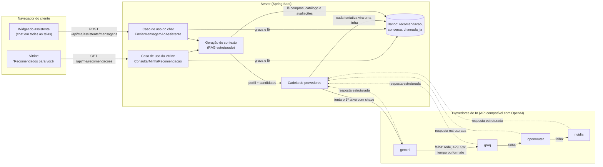
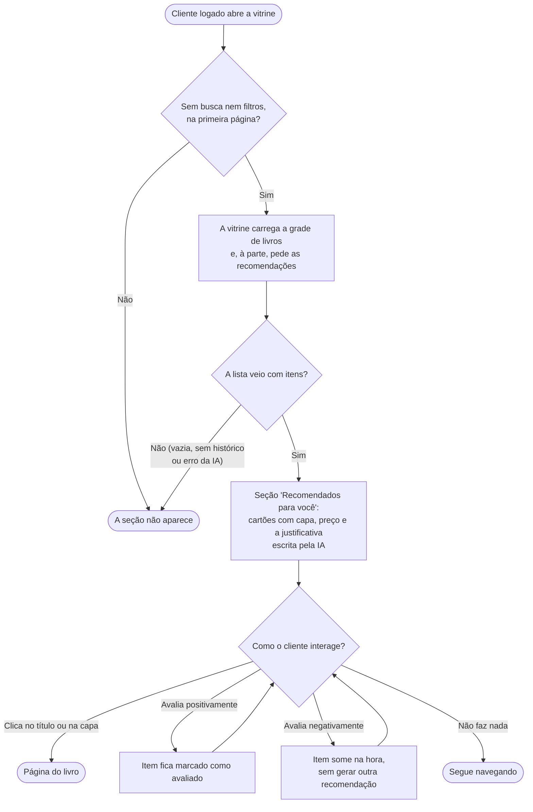
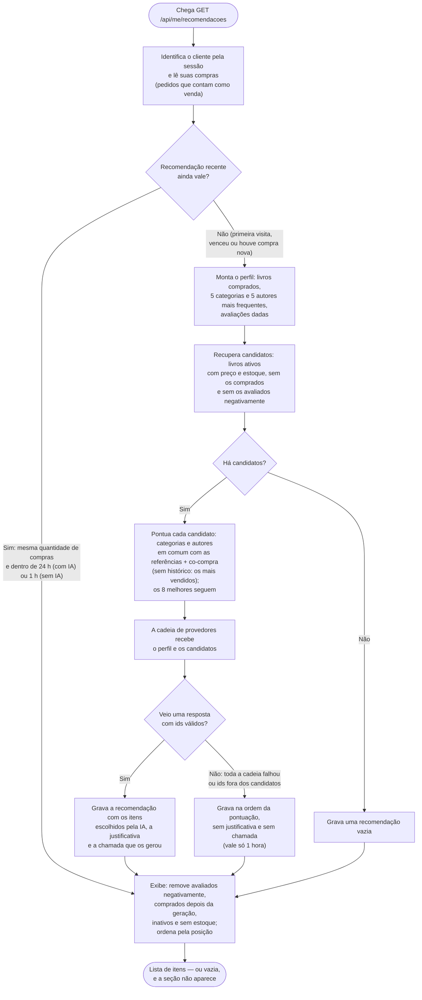
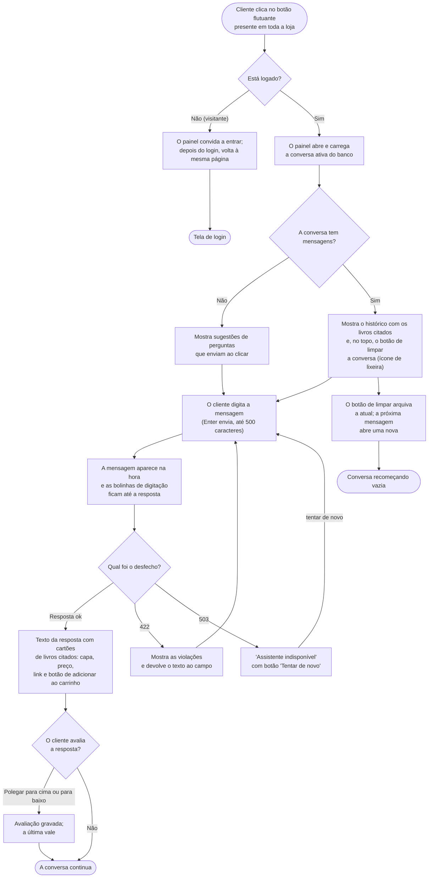
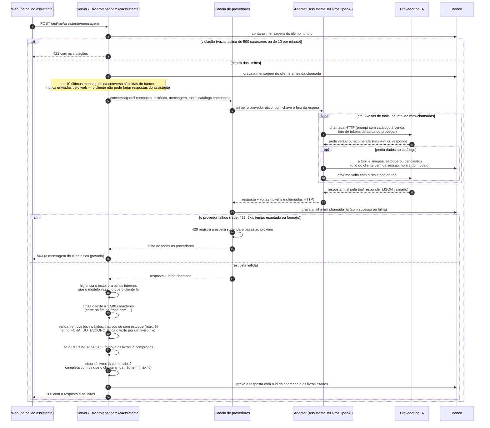

# Fluxo da recomendação personalizada

> **Pergunta que este documento responde:** como o cliente da livraria recebe recomendações de livros — na vitrine e no chat com o assistente — e o que o server faz, passo a passo, para produzi-las?
> **Público:** a equipe do projeto e o professor da disciplina LES. Não exige conhecimento do código; os nomes de arquivos aparecem só para rastreabilidade.
> **Escopo:** os dois fluxos do módulo de recomendação (`REC`, requisito `RNF-REC-001`): a seção "Recomendados para você" da vitrine e o widget do assistente (chat), do ponto de vista do cliente e do server.
> **Fora de escopo:** as telas do administrador (ordem e ativação dos provedores, métricas), o funcionamento interno de cada provedor de IA e o fluxo de compra/carrinho. Para ligar chaves e perfis, leia o [guia de configuração da IA](../guias/configuracao-da-ia.md).

## Resumo em 30 segundos

A livraria recomenda livros em dois lugares: uma seção no topo da vitrine, "Recomendados para você", e um chat flutuante presente em todas as telas da loja. Os dois são alimentados pelo mesmo motor, que vive no módulo `recomendacao` do server.

O motor não treina um modelo. Em vez disso, ele monta um contexto por cliente e o entrega a um modelo de IA generativa a cada chamada: o perfil (livros comprados, categorias e autores preferidos, avaliações) e uma lista de candidatos que o próprio server escolhe e pontua com regras determinísticas. Esse é o "treino" prometido pelo requisito — a personalização acompanha as compras e o feedback sem mudar o modelo.

Como os provedores gratuitos têm cotas baixas, o server mantém uma **cadeia de provedores** (Gemini, Groq, OpenRouter e NVIDIA NIM, nesta ordem): se um falha ou esgota a cota, o próximo atende. Toda tentativa, com sucesso ou falha, fica registrada no banco. Se toda a cadeia falhar, a vitrine ainda mostra os candidatos na ordem calculada pelo server, sem justificativa; o chat, por sua vez, avisa que o assistente está indisponível.

A IA nunca executa ações: ela apenas escolhe, justifica e cita livros. Adicionar ao carrinho é um botão da interface sobre os livros devolvidos. E o que a IA escreve nunca chega cru ao cliente: o server valida a resposta antes de gravar — no chat, higieniza o texto, corta despejos e confere os livros citados.

## Legenda

| Nome | O que é | Papel no fluxo |
|---|---|---|
| Cliente | Usuário logado com papel `CLIENTE` | Navega na loja, recebe as recomendações e avalia o que gostou ou não |
| Visitante | Usuário não logado | Vê o botão do assistente; ao abrir, é convidado a entrar |
| Web | A loja em `apps/web` (Preact no navegador) | Mostra a seção "Recomendados para você" na vitrine e o widget do assistente em todas as telas |
| Server | A API em `apps/server` (Spring Boot) | Identifica o cliente pela sessão, monta o contexto, chama a IA, valida a resposta e grava tudo |
| Módulo `recomendacao` | Parte do server dedicada ao `RNF-REC-001` | Casos de uso da vitrine e do chat, regras de validação e gravação |
| Cadeia de provedores | Componente do server que tenta os provedores em ordem | Chama o primeiro provedor disponível e passa ao próximo quando um falha; registra cada tentativa |
| Provedor de IA | Serviço externo com API compatível com OpenAI (Gemini, Groq, OpenRouter, NVIDIA NIM) | Recebe o prompt e devolve uma resposta estruturada em JSON |
| Adapter | `AssistenteDeLivrosOpenAi`, no server | Fala com um provedor: controla o loop de tools, os limites de chamadas, o teto de tokens de saída e a correção de formato |
| Banco | PostgreSQL ou H2, conforme o profile | Guarda `recomendacao`/`item_recomendacao` (vitrine), `conversa`/`mensagem_conversa`/`mensagem_livro` (chat), `chamada_ia` (log) e `provedor_ia` (cadeia) |
| Admin | Usuário com papel `ADMIN` | Fora deste fluxo, mas é quem muda a ordem e a ativação dos provedores sem reiniciar o server |

## 1. Visão geral

Quem participa da recomendação e como as partes se conectam. Observe primeiro as duas portas de entrada (vitrine e chat), depois o caminho comum: contexto, cadeia de provedores e banco.

O cliente chega por uma das duas portas. Na vitrine, o componente de recomendados faz um `GET /api/me/recomendacoes`; no chat, cada mensagem enviada faz um `POST /api/me/assistente/mensagens`. Não há streaming: uma requisição por mensagem, e a vitrine carrega a seção à parte da grade, então uma demora ou falha da IA nunca atrasa a lista de livros.

Dentro do server, os dois caminhos compartilham a **geração do contexto** (o "RAG estruturado" da [DEC-03](../decisoes/DEC-03-recomendacao-com-ia-generativa.md)): o server lê do banco o que o cliente comprou e avaliou, monta o perfil e escolhe os candidatos com regras determinísticas — sem IA e sem busca vetorial. O modelo só entra para **ordenar e justificar** na vitrine, ou para **conversar** no chat.

A cadeia tenta os provedores na ordem da tabela `provedor_ia` (semente: `gemini`, `groq`, `openrouter`, `nvidia` e `fake`, com o `fake` inativo). Um provedor só entra se estiver ativo, tiver chave na configuração e não estiver em espera por cota esgotada. Cada tentativa — sucesso ou falha — vira uma linha na tabela `chamada_ia`, que alimenta as métricas do admin. Se todos falharem, cada porta reage do seu jeito, como os diagramas seguintes mostram.

## 2. A vitrine pelo cliente

Qual é a experiência do cliente com a seção "Recomendados para você": quando ela aparece, o que mostra e o que cada avaliação faz.

A seção só existe para o cliente logado (papel `CLIENTE`), na vitrine sem busca e sem filtros, na primeira página — decisão da [DEC-03](../decisoes/DEC-03-recomendacao-com-ia-generativa.md) implementada em `mostrarRecomendados` (`apps/web/src/modulos/catalogo/regras/recomendados.ts`). Sem itens, a seção simplesmente não é renderizada, e a vitrine segue normal.

Cada cartão traz capa, título, autores, preço e uma **justificativa curta escrita pela IA** ("porque você comprou romances…"). Junto de cada item há botões de avaliação com ícones de polegar, um para cima e outro para baixo. A avaliação negativa faz o item desaparecer da tela imediatamente, sem gerar uma nova recomendação; o livro também sai das próximas gerações, porque entra na lista de excluídos do server. A positiva só marca o cartão, e o livro passa a contar como referência de gosto no futuro. Em ambos os casos **a última avaliação vale**, e o gesto alimenta tanto o perfil do cliente quanto a taxa de aprovação das métricas.

O clique no título ou na capa leva à página do livro, fora deste fluxo.

## 3. Como o server gera a recomendação da vitrine

Este diagrama detalha o que acontece dentro do `GET /api/me/recomendacoes`, no caso de uso `ConsultarMinhaRecomendacao`. A pergunta: como o server decide o que recomendar — e o que ele faz quando a IA não atende?

O primeiro trabalho do server é barato: identificar o cliente pela sessão, ler as compras e conferir se a recomendação mais recente ainda vale. **Reaproveitar é o caminho comum** — e ele dura 24 horas quando gerada com IA, 1 hora quando a IA falhou (para tentar de novo logo), e sempre acaba na próxima compra. A "compra" é contada pelo número de pedidos que contam como venda, não pela data: um pedido aprovado depois da geração também invalida a recomendação.

Só quando não há o que reaproveitar é que o server gera outra. O **perfil** reúne os livros comprados (do mais recente, sem repetição), as 5 categorias e os 5 autores mais frequentes entre eles e as avaliações que o cliente deu. Os **candidatos** são os livros à venda — ativos, com preço e com estoque — menos os já comprados e menos os avaliados negativamente. As **referências de gosto** são os comprados mais os avaliados positivamente. A pontuação soma, para cada candidato, as categorias e autores em comum com as referências e o número de clientes da **co-compra** ("quem comprou X também comprou Y"); sem nenhum histórico, a pontuação vira "os mais vendidos". Os 8 de maior pontuação vão à IA.

A IA recebe perfil e candidatos e devolve uma **saída estruturada**: ids escolhidos, em ordem, cada um com uma justificativa curta. O server filtra a resposta — só ficam ids que estavam entre os candidatos, porque o modelo pode citar livros fora da lista. Se a IA respondeu, a recomendação é gravada apontando para a chamada que a gerou; se toda a cadeia falhou, é gravada **na ordem da pontuação, sem justificativa**, e conta como "recomendação sem IA" nas métricas — a vitrine nunca fica vazia por culpa da IA.

Na exibição, saem os itens avaliados negativamente, os livros comprados depois da geração e os que ficaram inativos ou sem estoque. Sobrou algo? A seção aparece; nada? Ela nem é renderizada.

## 4. O assistente pelo cliente

Qual é a experiência do chat: onde o botão aparece, o que o cliente vê ao abrir e o que acontece com cada mensagem.

O botão flutuante (um balão de fala como ícone, canto inferior direito) existe em **todas as telas da loja e nenhuma do admin** — o widget é montado fora das rotas, em `apps/web/src/app.tsx`. Aberto ou fechado, o estado sobrevive à navegação e fica guardado na aba do navegador; Esc fecha o painel e devolve o foco ao botão. Para o visitante, o painel apenas convida a entrar, com retorno à mesma página depois do login.

Ao abrir, o painel carrega a conversa ativa do servidor: o histórico segue no banco, não no navegador, então a conversa é retomada em qualquer acesso. Vazia, a tela sugere perguntas prontas que enviam a mensagem com um clique. O envio segue o padrão de mensageiros: a mensagem do cliente aparece na hora, um indicador de digitação (três bolinhas animadas, com "Digitando…" como rótulo para leitores de tela) fica até a resposta e o campo limita a 500 caracteres (o mesmo limite que o server aplica, contando por código de caractere).

Cada resposta do assistente chega com um **tipo** invisível ao cliente (recomendação, busca, dúvida ou fora do escopo) e pode vir com cartões de livros citados: capa, preço, link para o detalhe e um botão para adicionar ao carrinho. Pedidos impossíveis ou que a loja não atende — ler dirigindo, pedir um cupom de desconto, mexer no pedido ou no carrinho — são recusados com cortesia no próprio texto do assistente; só um assunto que nem é da loja recebe o aviso fixo de fora do escopo. **A IA nunca adiciona nada ao carrinho** — isso é sempre um clique do cliente. Cada resposta tem os botões de avaliação de polegar, para cima e para baixo; a avaliação entra no perfil futuro e nas métricas, e a última vale.

Os desfechos de erro são explícitos: o 422 devolve o texto ao campo com o motivo (mensagem longa demais ou acima de 10 mensagens por minuto); o 503 mostra "assistente indisponível" com "tentar de novo" — seguro porque o server não regrava uma mensagem que já está pendente de resposta. O botão de limpar (a lixeira no topo do painel) arquiva a conversa atual, que fica no banco sem ser exibida, e a próxima mensagem abre uma nova.

## 5. O que o server faz com cada mensagem

Este diagrama responde: entre o envio e a resposta, o que acontece dentro do server? Mostra as validações, a gravação antes da chamada, o loop de tools do adapter e a verificação final — higiene do texto, teto de caracteres, validação, remoção dos comprados e o fallback que indica os livros que o cliente ainda não tem. É o detalhe do passo `POST /api/me/assistente/mensagens` do diagrama 1.

A mensagem passa primeiro pelas proteções, **antes** de qualquer chamada à IA: no máximo 500 caracteres e no máximo 10 mensagens por minuto, contadas no banco. Uma violação responde 422 e nada é gravado. Passando, a mensagem do cliente é gravada **antes** da chamada — se a IA inteira cair, a mensagem não se perde, e o "tentar de novo" do painel não cria duplicata, porque o server reconhece o reenvio da última mensagem sem resposta.

O contexto da conversa é montado em seguida, fora de qualquer transação (a chamada à IA pode levar segundos e não pode segurar o banco): perfil compacto, as 10 últimas mensagens da conversa ativa **lidas do banco** — nunca da requisição, para o cliente não poder forjar respostas do assistente — e o catálogo à venda em formato enxuto, uma linha por livro (`id|titulo|autores|categorias|preco`), para poupar tokens das cotas gratuitas. O modelo recebe ainda duas **tools de leitura**: `verLivro` (sinopse e estoque de um livro) e `recomendarParaMim` (os mesmos candidatos pontuados da vitrine). O id do cliente fica preso na sessão: o modelo nunca o informa.

O prompt da conversa fixa o contrato: nunca listar o catálogo completo nem despejar listas ou JSON (quando vários livros servirem, citar alguns, os mais relevantes); para recomendar, chamar `recomendarParaMim` e citar só o que ela devolver, nunca livros que o cliente já tem; nunca escrever ids internos no texto que o cliente lê. As recusas ficam separadas em dois casos: assunto que nem é da loja (política, receita, o modelo por trás do assistente) vira FORA_DO_ESCOPO; pedido sobre livros ou sobre a loja que o assistente não pode ou não deve atender — impossibilidades como ler dirigindo ou um livro que flutue, cupons de desconto, mexer em pedido ou carrinho — vira DUVIDA, recusado com cortesia no próprio texto, sem inventar livros, condições nem promessas. Como o comportamento do modelo é probabilístico, cada regra do prompt tem um reforço server-side depois da chamada.

O adapter controla o loop de tools, uma chamada HTTP por volta, com os limites que protegem a cota: no máximo 3 voltas de tools, 1 correção de formato, um total de chamadas HTTP por provedor (`max-chamadas`, padrão 5) e um teto de tokens de saída por provedor (`max-tokens`, padrão sem teto; 800 no Gemini e no Groq, 1.200 no OpenRouter e no NVIDIA), que vai no corpo de toda chamada, voltas de tools inclusas — sem ele, provedores como o Groq reservam a saída pedida contra o limite por minuto e recusam com 429 antes de escrever qualquer texto. Passar dos limites de voltas ou de chamadas conta como falha do provedor e a cadeia segue; um texto cortado no meio pelo teto de saída vira JSON inválido e cai na correção de formato — e, se persistir, na cadeia. No formato padrão (`ferramenta`), a resposta final chega pela tool `responder` com um JSON validado pelo Spring AI — nunca texto livre interpretado pelo server.

Depois da chamada, o server confia e verifica, em cinco passos, antes de gravar. Primeiro **higieniza o texto**: saem as anotações de id que o modelo vaza — "(id 32)", pares "id": 12 de um despejo de JSON — do que o cliente vai ler. Depois **limita o texto a 1.500 caracteres**: acima do teto, corta no último fim de frase e acrescenta "…"; é a trava contra um despejo do catálogo inteiro, e vale inclusive para o provedor fake. Em seguida **valida**: só ficam livros citados que existem, estão ativos e têm estoque, no máximo 6, sem repetição; texto em branco ganha um texto padrão; e a resposta fora do escopo tem o texto do modelo descartado e trocado por um aviso fixo, sem livros. Então **remove da recomendação os livros que o cliente já comprou** — buscas e dúvidas mantêm os seus, porque o cliente pode perguntar de um livro que já tem. E se a remoção esvaziar uma recomendação que citava livros, o server **completa a resposta com os candidatos que o cliente ainda não tem**, os mesmos da vitrine e da tool `recomendarParaMim`, até o teto de 6, com um texto fixo curto — as consultas agregadas de vendas que alimentam a pontuação só correm nesse disparo; sem candidato nenhum (o cliente já tem ou avaliou tudo à venda), a resposta fica em texto fixo, sem livros. Só então a resposta é gravada apontando para a chamada que a gerou, com os livros citados, e volta para o painel virar cartões.

## Premissas e pontos em aberto

- **Premissa:** o documento descreve o comportamento do profile padrão, sem o provedor `fake`. No profile `dev` e nos testes, o `fake` (determinístico, sem rede) entra no fim da cadeia e evita o 503; na apresentação, ele fica inativo e uma falha dos provedores reais não é mascarada.
- **Premissa:** a ordem dos provedores é a da semente (`gemini`, `groq`, `openrouter`, `nvidia`), mas o admin pode mudá-la e ligar/desligar provedores em tempo de execução, na aba "Assistente"; a cadeia relê a tabela em até 30 segundos.
- **Premissa:** o formato de resposta descrito é o padrão `ferramenta` (resposta final pela tool `responder`). Um provedor configurado com `json-schema` ou `instrucoes` entrega o mesmo JSON no texto da mensagem, sem a tool de resposta — mesma validação, mesmo efeito.
- **Premissa:** os tetos citados são os valores atuais da configuração: `max-tokens` por provedor (800 no Gemini e no Groq, 1.200 no OpenRouter e no NVIDIA, ajustáveis em `application.yml`) e 1.500 caracteres no texto gravado, fixo no código.
- **Ponto em aberto:** este documento não descreve as métricas da IA nem a tela do admin que as exibe; se for preciso documentá-las, vale um fluxo próprio (`GET /api/admin/ia/metricas` sobre a tabela `chamada_ia`).

## Glossário

| Termo | Definição |
|---|---|
| RAG estruturado | Forma usada no projeto de "treinar" o modelo sem treino: cada chamada leva o perfil do cliente e os candidatos escolhidos por regras determinísticas, em vez de embeddings ou busca vetorial |
| Perfil do cliente | Livros comprados, as 5 categorias e 5 autores mais frequentes e as avaliações dadas; vai no prompt de cada chamada |
| Candidatos | Livros à venda (ativos, com preço e estoque) que o server pontua e oferece à IA, já sem os comprados e sem os avaliados negativamente |
| Referências de gosto | Livros que representam o gosto do cliente na pontuação: os comprados e os recomendados avaliados positivamente |
| Co-compra | Sinal "quem comprou X também comprou Y", contado a partir das compras registradas de todos os clientes |
| Cadeia de provedores | Lista ordenada de provedores de IA (tabela `provedor_ia`); o server chama o primeiro disponível e passa ao próximo quando um falha |
| Provedor de IA | Serviço externo com API compatível com OpenAI: Gemini, Groq, OpenRouter ou NVIDIA NIM; cada um tem cota gratuita e chave própria |
| Adapter | Código do server que fala com um provedor (`AssistenteDeLivrosOpenAi`); controla o loop de tools, os limites de chamadas, o teto de tokens de saída e a correção de formato |
| Tool (function calling) | Função que o modelo pode chamar durante a resposta; aqui só de leitura (`verLivro`, `recomendarParaMim`), mais a `responder`, que entrega a resposta final |
| Saída estruturada | Resposta do modelo em JSON validado (tipo, texto e ids de livros), nunca texto livre interpretado pelo server |
| Higienização de ids | Regra que tira, antes de gravar, as anotações mecânicas de id que o modelo vaza no texto — "(id 32)", pares "id": 12 de um JSON — sem tocar no eco do que o próprio cliente digitou |
| Teto do texto da resposta | Limite de 1.500 caracteres no texto gravado e exibido; acima dele, corte no último fim de frase com "…" acrescentado |
| `DUVIDA` | Tipo de resposta que esclarece uma dúvida e recusa, com cortesia no próprio texto do modelo, pedidos sobre livros ou sobre a loja que o assistente não pode ou não deve atender (impossibilidades, cupons de desconto, mexer em pedido ou carrinho) |
| `FORA_DO_ESCOPO` | Tipo de resposta para assunto que nem é da loja (política, receita, clima, o modelo por trás do assistente); o server descarta o texto do modelo e grava um aviso fixo, sem livros |
| `chamada_ia` | Tabela de log com uma linha por tentativa a um provedor: operação, latência, resultado, código HTTP, tokens e número de voltas |
| 429 e espera de cota | Resposta "limite excedido" de um provedor; quem respondeu 429 sai da cadeia pelo tempo sugerido (entre 10 s e 5 min) ou até a meia-noite, na cota diária |
| `max-chamadas` | Teto de chamadas HTTP a um provedor por mensagem (padrão 5), somando voltas de tools e correção de formato |
| `max-tokens` | Teto de tokens de saída por provedor, enviado no corpo de toda chamada HTTP (padrão sem teto; 800 no Gemini e no Groq, 1.200 no OpenRouter e no NVIDIA) |
| Semente (seed) | Scripts SQL que povoam o banco na inicialização: livros, estoque, a cadeia de provedores etc. |
| Profile `dev` | Perfil de execução que ativa o provedor `fake`, para desenvolver e testar sem rede nem chave |

## Fontes consultadas

- [`docs/requisitos/recomendacao.md`](../requisitos/recomendacao.md) — requisito `RNF-REC-001` e matriz de rastreabilidade, lido em 2026-11-22.
- [`docs/decisoes/DEC-03-recomendacao-com-ia-generativa.md`](../decisoes/DEC-03-recomendacao-com-ia-generativa.md) — decisões do módulo: cadeia, RAG estruturado, proteções, gravação e métricas, lido em 2026-11-22.
- [`docs/guias/configuracao-da-ia.md`](../guias/configuracao-da-ia.md) — funcionamento da cadeia por provedor e o formato compacto do catálogo, lido em 2026-11-22.
- `apps/server/src/main/java/br/fatec/les/livraria/recomendacao/aplicacao/casodeuso/ConsultarMinhaRecomendacao.java` — fluxo da vitrine: reaproveitamento, geração e exibição.
- `apps/server/src/main/java/br/fatec/les/livraria/recomendacao/aplicacao/casodeuso/EnviarMensagemAoAssistente.java` — fluxo do chat: validações, gravação antes da chamada e a orquestração da verificação pós-chamada (higiene, teto, validação, comprados e fallback).
- `apps/server/src/main/java/br/fatec/les/livraria/recomendacao/aplicacao/casodeuso/CadeiaDeProvedores.java` — ordem, cache de 30 s, espera por 429 e registro em `chamada_ia`.
- `apps/server/src/main/java/br/fatec/les/livraria/recomendacao/aplicacao/RecuperarCandidatos.java`, `MontarPerfilDoCliente.java` e `dominio/calculo/PontuarCandidatos.java` — perfil, exclusões, referências, co-compra e o corte dos 8.
- `apps/server/src/main/java/br/fatec/les/livraria/recomendacao/dominio/calculo/RecomendacaoAindaValida.java` — validade de 24 h / 1 h e a invalidação por compra.
- `apps/server/src/main/java/br/fatec/les/livraria/recomendacao/dominio/calculo/ValidarRespostaDoAssistente.java` — filtro pós-chamada do chat e os textos fixos.
- `apps/server/src/main/java/br/fatec/les/livraria/recomendacao/dominio/calculo/HigienizarIdsDoTexto.java`, `LimitarTextoDaResposta.java`, `RemoverLivrosCompradosDaRecomendacao.java` e `IndicarLivrosQueOClienteNaoTem.java` — higiene de ids, teto de 1.500 caracteres, remoção dos comprados e o fallback que indica os livros que o cliente ainda não tem.
- `apps/server/src/main/java/br/fatec/les/livraria/recomendacao/infraestrutura/externo/AssistenteDeLivrosOpenAi.java` — loop de tools, limites, teto de tokens de saída, correção de formato e o prompt da conversa (contrato anti-despejo, recusas e recomendação via `recomendarParaMim`).
- `apps/server/src/main/java/br/fatec/les/livraria/recomendacao/infraestrutura/PropriedadesIa.java` e `apps/server/src/main/resources/application.yml` — opções por provedor, entre elas o `max-tokens` (800 no gemini e no groq, 1.200 no openrouter e no nvidia).
- `apps/server/src/main/java/br/fatec/les/livraria/recomendacao/infraestrutura/externo/FerramentasParaIa.java` e `ContextoCompactoDoChat.java` — tools `verLivro` e `recomendarParaMim`, catálogo `id|titulo|autores|categorias|preco`.
- `apps/server/src/main/java/br/fatec/les/livraria/recomendacao/infraestrutura/web/RecomendacaoController.java` e `AssistenteController.java` — endpoints e códigos de resposta.
- `apps/web/src/app.tsx` (linha 143), `apps/web/src/modulos/assistente/componentes/Assistente.tsx` e `PainelDoAssistente.tsx` — montagem do widget, carregamento da conversa, envio e desfechos; `apps/web/src/ui/BotoesDeAvaliacao.tsx` e `ui/icones/` — os ícones de balão, polegar e lixeira.
- `apps/web/src/modulos/catalogo/paginas/Vitrine.tsx` (linhas 162–163), `componentes/Recomendados.tsx` e `regras/recomendados.ts` — quando a seção aparece e o efeito das avaliações.
- `apps/web/src/modulos/assistente/regras/conversa.ts` — limite de 500 caracteres, sugestões, reenvio seguro e o convite do visitante.
