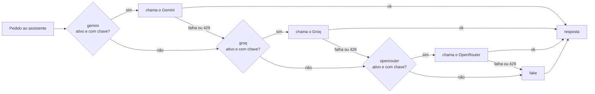

# Configuração do assistente com IA

Como ligar a recomendação e o chat com IA generativa (RNF-REC-001) a provedores reais. As regras do módulo estão no
[DEC-03](../decisoes/DEC-03-recomendacao-com-ia-generativa.md).

## Em resumo

- **Sem nenhuma configuração, tudo funciona.** O assistente usa o provedor `fake`, que responde de forma
  determinística e sem rede. É assim em `mvn test`, nos E2E e na primeira execução.
- Para usar IA de verdade, crie a chave gratuita de pelo menos um provedor e defina a variável de ambiente
  correspondente antes de subir o `server`.
- Com mais de uma chave, o server tenta os provedores na ordem da cadeia e passa ao próximo quando um falha ou
  esgota a cota.

## Como a cadeia funciona



- **Ordem padrão:** `gemini`, `groq`, `openrouter` e `fake`. O administrador muda a ordem e liga ou desliga
  provedores na aba **Assistente** do admin, sem reiniciar. A mudança fica gravada no banco.
- **Cota esgotada:** um provedor que respondeu HTTP 429 fica fora da cadeia por 5 minutos.
- **Registro:** toda tentativa, com sucesso ou falha, fica registrada e aparece nas métricas da mesma aba (latência,
  taxa de sucesso, erros por tipo e tokens).
- **Provedor `fake` desligado:** se todos os provedores ativos falharem, a vitrine mostra as recomendações
  calculadas pelo server, sem justificativa, e o chat avisa que o assistente está indisponível.

## Variáveis de ambiente

| Provedor | Chave | Modelo (opcional) |
|---|---|---|
| Gemini | `IA_GEMINI_CHAVE` | `IA_GEMINI_MODELO` |
| Groq | `IA_GROQ_CHAVE` | `IA_GROQ_MODELO` |
| OpenRouter | `IA_OPENROUTER_CHAVE` | `IA_OPENROUTER_MODELO` |

- Defina só as chaves dos provedores que for usar. Um provedor sem chave é pulado.
- O `application.yml` já traz um modelo gratuito para cada provedor: `gemini-2.5-flash-lite` no Gemini,
  `openai/gpt-oss-120b` no Groq e `google/gemma-4-31b-it:free` no OpenRouter. A variável de modelo só é necessária
  para trocá-lo.
- Cada chamada tem tempo limite de 20 segundos (`livraria.ia.tempo-limite`). Passado esse tempo, a chamada falha
  como `TEMPO_ESGOTADO` e a cadeia passa ao próximo provedor.
- O modelo escolhido precisa aceitar **tool calling** (chamada de funções) e **saída estruturada** (JSON). Sem isso,
  as respostas falham como `RESPOSTA_INVALIDA` e a cadeia passa ao próximo provedor.
- As chaves nunca vão para o repositório nem para o banco, e a API não as expõe.

## Obter as chaves

Os três planos são gratuitos e não pedem cartão de crédito. Os limites e a lista de modelos gratuitos mudam com
frequência, então confira nas páginas indicadas.

### Gemini (Google AI Studio)

1. Acesse o [Google AI Studio](https://aistudio.google.com/) e entre com uma conta Google.
2. Abra [Get API key](https://aistudio.google.com/apikey) e clique em **Create API key**. Se pedir, aceite os termos
   e crie um projeto do Google Cloud. Não é preciso ativar o faturamento.
3. Copie a chave para `IA_GEMINI_CHAVE`.

- **Modelos:** use um modelo **Flash** ou **Flash-Lite**, que são os do plano gratuito. A lista oficial está em
  [modelos do Gemini](https://ai.google.dev/gemini-api/docs/models).
- **Limites:** variam por projeto e aparecem no próprio AI Studio. A referência é a página de
  [limites de taxa](https://ai.google.dev/gemini-api/docs/rate-limits).
- **Compatibilidade com OpenAI:** o server usa o
  [endpoint compatível com OpenAI](https://ai.google.dev/gemini-api/docs/openai) do Gemini.
- **Atenção:** no plano gratuito, o Google pode usar as entradas e saídas para melhorar os modelos. Os dados do
  projeto são fictícios, então isso não é problema aqui.

### Groq

1. Crie uma conta no [GroqCloud](https://console.groq.com/) com e-mail, Google ou GitHub.
2. Abra [API Keys](https://console.groq.com/keys) e clique em **Create API Key**.
3. Copie a chave para `IA_GROQ_CHAVE`. Ela só é mostrada uma vez.

- **Modelos:** a lista está em [modelos do Groq](https://console.groq.com/docs/models). Escolha um com suporte a
  [tool use](https://console.groq.com/docs/tool-use).
- **Limites:** valem por modelo e por organização, e estão em
  [limites da conta](https://console.groq.com/settings/limits).

### OpenRouter

1. Crie uma conta no [OpenRouter](https://openrouter.ai/).
2. Abra [Keys](https://openrouter.ai/settings/keys) e clique em **Create Key**. O limite de crédito pode ficar
   vazio.
3. Copie a chave para `IA_OPENROUTER_CHAVE`.

- **Modelos:** os gratuitos terminam em `:free`. Para ver só os gratuitos que aceitam ferramentas, use o filtro da
  [lista de modelos](https://openrouter.ai/models?max_price=0&supported_parameters=tools).
- **Limites:** a cota diária dos modelos gratuitos é pequena e sobe se a conta já tiver comprado créditos. Os
  valores atuais estão em [limites](https://openrouter.ai/docs/api-reference/limits).
- **Atenção:** os modelos gratuitos podem sair do ar sem aviso. Se as chamadas começarem a falhar com
  `ERRO_HTTP` 404, troque `IA_OPENROUTER_MODELO`.

## Subir o server com as chaves

No terminal, em `apps/server`:

```bash
export IA_GEMINI_CHAVE="sua-chave"
export IA_GROQ_CHAVE="sua-chave"
mvn spring-boot:run
```

Com o jar da demonstração:

```bash
IA_GEMINI_CHAVE="sua-chave" IA_GROQ_CHAVE="sua-chave" java -jar target/livraria-server-*.jar
```

Na IDE, defina as mesmas variáveis em *Environment variables* da configuração de execução.

## Conferir se funcionou

1. Entre como administrador e abra a aba **Assistente**.
2. Os provedores com chave aparecem como **configurados**. Os sem chave aparecem como **sem chave** e são pulados.
3. Entre como cliente, abra o assistente no botão do canto inferior direito e envie uma mensagem.
4. Volte às métricas: a chamada aparece com o provedor que respondeu, a latência e o resultado.

## Problemas comuns

| Sintoma nas métricas | Causa provável | O que fazer |
|---|---|---|
| Todas as chamadas no `fake` | nenhuma chave definida no processo do server | confira as variáveis no mesmo terminal ou na configuração da IDE e reinicie |
| `ERRO_HTTP` 401 ou 403 | chave inválida ou revogada | gere outra chave no painel do provedor |
| `COTA_ESGOTADA` | limite gratuito atingido | aguarde, ou ponha outro provedor na frente da cadeia |
| `ERRO_HTTP` 404 | modelo inexistente ou retirado | troque a variável `IA_*_MODELO` |
| `RESPOSTA_INVALIDA` | o modelo não segue o formato JSON ou não aceita ferramentas | escolha um modelo com tool calling e saída estruturada |
| `TEMPO_ESGOTADO` ou `ERRO_DE_REDE` | rede da apresentação instável ou provedor lento | deixe o `fake` ativo no fim da cadeia |

Para a apresentação, é recomendável configurar pelo menos dois provedores e manter o `fake` ativo no fim da
cadeia. Assim, uma cota esgotada nunca derruba o assistente.
