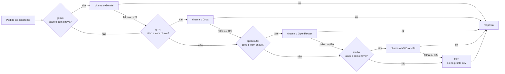

# Configuração do assistente com IA

Como ligar a recomendação e o chat com IA generativa (RNF-REC-001) a provedores reais. As regras do módulo estão no
[DEC-03](../decisoes/DEC-03-recomendacao-com-ia-generativa.md).

## Em resumo

- **Sem chave, o assistente fica indisponível.** O provedor `fake` existe, mas fica inativo por padrão; ele só é
  ativado no profile `dev` e nos testes, onde responde de forma determinística e sem rede.
- Para usar IA de verdade, crie a chave gratuita de pelo menos um provedor e defina a variável de ambiente
  correspondente antes de subir o `server`.
- Com mais de uma chave, o server tenta os provedores na ordem da cadeia e passa ao próximo quando um falha ou
  esgota a cota.
- No desenvolvimento com o `fake`, suba com `-Dspring-boot.run.profiles=h2,dev`; na apresentação, não use o
  profile `dev`.

## Como a cadeia funciona



- **Ordem padrão:** `gemini`, `groq`, `openrouter`, `nvidia` e `fake`, com o `fake` inativo. O administrador muda a
  ordem e liga ou desliga provedores na aba **Assistente** do admin, sem reiniciar. A mudança fica gravada no banco.
- **No profile padrão e na apresentação**, a cadeia termina no último provedor real; o `fake` não entra. Se todos
  falharem, o assistente fica indisponível. **No profile `dev`**, o `fake` entra no fim da cadeia e atende sem rede.
- **Cota esgotada:** um provedor que respondeu HTTP 429 fica fora da cadeia pelo tempo indicado no cabeçalho
  `Retry-After` (segundos ou data HTTP) ou no texto da mensagem, como "try again in 7.5s" ou "retry in 1m30s". O
  prazo fica entre 10 segundos e 5 minutos; sem indicação, são 5 minutos. Se a mensagem aponta cota diária ("per
  day", "daily", "RPD"), o provedor só volta à meia-noite. No profile `dev`, o `fake`, no fim da cadeia, atende
  enquanto isso; na apresentação, o assistente fica indisponível até o provedor voltar.
- **Registro:** toda tentativa, com sucesso ou falha, fica registrada e aparece nas métricas da mesma aba (latência,
  taxa de sucesso, erros por tipo e tokens). Cada linha também guarda quantas chamadas HTTP a mensagem fez
  (`chamadas_http`) e os tokens de cada volta (`tokens_das_voltas`), além dos tokens somados.
- **Provedor `fake` inativo (padrão):** se todos os provedores reais ativos falharem, a vitrine mostra as
  recomendações calculadas pelo server, sem justificativa, e o chat avisa que o assistente está indisponível. No
  profile `dev`, o `fake` evita esse cenário.

## O que vai no prompt do chat

- O catálogo à venda vai em uma linha por livro, com o cabeçalho `id|titulo|autores|categorias|preco` e os valores
  separados por `|`, por exemplo `12|Dom Casmurro|Machado de Assis|Romance|47.88`. Isso reduz os tokens de cada
  mensagem e evita repetir títulos e categorias.
- O perfil do cliente no chat leva só os ids dos livros comprados que estão no catálogo, o título dos que não estão,
  até 5 categorias e autores e os ids das avaliações positivas e negativas. A vitrine continua usando o perfil
  completo.
- O modelo vê só as tools `verLivro` (sinopse e estoque) e `recomendarParaMim` (sugestões pelo histórico). Buscar por
  título, autor, categoria ou preço é feito no próprio catálogo do prompt.

## Variáveis de ambiente

| Provedor | Chave | Modelo (opcional) |
|---|---|---|
| Gemini | `IA_GEMINI_CHAVE` | `IA_GEMINI_MODELO` |
| Groq | `IA_GROQ_CHAVE` | `IA_GROQ_MODELO` |
| OpenRouter | `IA_OPENROUTER_CHAVE` | `IA_OPENROUTER_MODELO` |
| NVIDIA NIM | `IA_NVIDIA_CHAVE` | `IA_NVIDIA_MODELO` |

- Defina só as chaves dos provedores que for usar. Um provedor sem chave é pulado.
- O `application.yml` já traz um modelo gratuito para cada provedor: `gemini-3.5-flash-lite` no Gemini,
  `qwen/qwen3.8-27b` no Groq, `google/gemma-4-31b-it:free` no OpenRouter e `nvidia/nemotron-3.5-super-vl-120b-a12b` no
  NVIDIA NIM. A variável de modelo só é necessária
  para trocá-lo.
- Cada chamada tem tempo limite de 20 segundos (`livraria.ia.tempo-limite`). Passado esse tempo, a chamada falha
  como `TEMPO_ESGOTADO` e a cadeia passa ao próximo provedor.
- O modelo escolhido precisa aceitar **tool calling** (chamada de funções) e **saída estruturada** (JSON). Sem isso,
  as respostas falham como `RESPOSTA_INVALIDA` e a cadeia passa ao próximo provedor.
- As chaves nunca vão para o repositório nem para o banco, e a API não as expõe.

## Opções de cada provedor

Cada item de `livraria.ia.provedores.<nome>` vira um adapter próprio. Além de `url-base`, `modelo` e `chave`, todas
as opções abaixo são opcionais e têm padrão:

| Opção | Valores | Padrão | Efeito |
|---|---|---|---|
| `tool-choice` | `auto`, `required` | `auto` | Só tem efeito nos formatos `json-schema` e `instrucoes`: com `required`, a primeira volta obriga o modelo a chamar ao menos uma ferramenta, e as voltas seguintes ficam em `auto`. Com `formato: ferramenta` (o padrão), esta opção é ignorada e o `tool_choice` é sempre `required`, porque a resposta final precisa vir da tool `responder`. |
| `formato` | `ferramenta`, `json-schema`, `instrucoes` | `ferramenta` | Com `ferramenta`, o chat anuncia a tool `responder`, que entrega o tipo, o texto e os livros citados e encerra o loop sem outra chamada. Com `json-schema`, a resposta final é o JSON do texto no `response_format` nativo da API OpenAI, sem a tool `responder` e sem as instruções de formato no prompt. Com `instrucoes`, o JSON esperado vai nas instruções do prompt, também sem a tool `responder`. A recomendação da vitrine usa `json-schema` quando configurado e instruções nos demais formatos. |
| `cabecalhos` | mapa de textos | vazio | Cabeçalhos HTTP extras enviados em toda chamada, por exemplo `HTTP-Referer` e `X-Title` do OpenRouter. |
| `max-chamadas` | inteiro ≥ 1 | `5` | Máximo de chamadas HTTP ao provedor por mensagem, contando as voltas que executam tools e a correção de formato. Passar do limite grava `LIMITE_DE_CHAMADAS` e a cadeia passa ao próximo provedor. |

Exemplo do `application.yml`:

```yaml
livraria:
  ia:
    provedores:
      openrouter:
        url-base: https://openrouter.ai/api/v1
        modelo: ${IA_OPENROUTER_MODELO:google/gemma-4-31b-it:free}
        chave: ${IA_OPENROUTER_CHAVE:}
        tool-choice: auto
        formato: ferramenta
        max-chamadas: 5
        cabecalhos:
          X-Title: Livraria LES
```

Um valor fora dos aceitos impede a subida com uma mensagem no formato
`livraria.ia.provedores.*.formato deve ser ferramenta, json-schema ou instrucoes.`; `max-chamadas` menor que 1 é
recusado do mesmo jeito.

O chat tem até 3 voltas que executam tools de leitura, uma correção de formato e o total de chamadas HTTP dentro de
`max-chamadas`. Passar de qualquer limite é falha do provedor, com o resultado `LIMITE_DE_CHAMADAS`, e a cadeia segue
para o próximo.

## Adicionar um provedor só por configuração

Não há `@Bean` por provedor. Para acrescentar outro serviço compatível com a API OpenAI:

1. Declare a conexão em `livraria.ia.provedores.<nome>`, com `url-base`, `modelo`, `chave` e, se precisar, as opções
   acima. A chave pode vir de uma variável de ambiente, como nos provedores que já existem.
2. Inclua o nome em `seed/500_provedores_ia.sql` (tabela `provedor_ia`) com a ordem e a ativação desejadas.

Na subida, o item vira o bean `assistente-<nome>`, do mesmo tipo dos demais, e a cadeia passa a considerá-lo na ordem
da tabela. A ordem e a ativação continuam editáveis na aba **Assistente** do admin, sem reiniciar. Não é preciso
alterar código nem reiniciar o `web`.

## Obter as chaves

Os planos são gratuitos e não pedem cartão de crédito. Os limites e a lista de modelos gratuitos mudam com
frequência, então confira nas páginas indicadas.

### Gemini (Google AI Studio)

1. Acesse o [Google AI Studio](https://aistudio.google.com/) e entre com uma conta Google.
2. Abra [Get API key](https://aistudio.google.com/apikey) e clique em **Create API key**. Se pedir, aceite os termos
   e crie um projeto do Google Cloud. Não é preciso ativar o faturamento.
3. Copie a chave para `IA_GEMINI_CHAVE`.

- **Modelos:** use um modelo **Flash** ou **Flash-Lite**, que são os do plano gratuito. A lista oficial está em
  [modelos do Gemini](https://ai.google.dev/gemini-api/docs/models).
- **Limites:** variam por projeto e aparecem no próprio AI Studio. A referência é a página de
  [limites de taxa](https://ai.google.dev/gemini-api/docs/rate-limits).
- **Compatibilidade com OpenAI:** o server usa o
  [endpoint compatível com OpenAI](https://ai.google.dev/gemini-api/docs/openai) do Gemini.
- **Atenção:** no plano gratuito, o Google pode usar as entradas e saídas para melhorar os modelos. Os dados do
  projeto são fictícios, então isso não é problema aqui.

### Groq

1. Crie uma conta no [GroqCloud](https://console.groq.com/) com e-mail, Google ou GitHub.
2. Abra [API Keys](https://console.groq.com/keys) e clique em **Create API Key**.
3. Copie a chave para `IA_GROQ_CHAVE`. Ela só é mostrada uma vez.

- **Modelos:** a lista está em [modelos do Groq](https://console.groq.com/docs/models). Escolha um com suporte a
  [tool use](https://console.groq.com/docs/tool-use).
- **Limites:** valem por modelo e por organização, e estão em
  [limites da conta](https://console.groq.com/settings/limits).

### OpenRouter

1. Crie uma conta no [OpenRouter](https://openrouter.ai/).
2. Abra [Keys](https://openrouter.ai/settings/keys) e clique em **Create Key**. O limite de crédito pode ficar
   vazio.
3. Copie a chave para `IA_OPENROUTER_CHAVE`.

- **Modelos:** os gratuitos terminam em `:free`. Para ver só os gratuitos que aceitam ferramentas, use o filtro da
  [lista de modelos](https://openrouter.ai/models?max_price=0&supported_parameters=tools).
- **Limites:** a cota diária dos modelos gratuitos é pequena e sobe se a conta já tiver comprado créditos. Os
  valores atuais estão em [limites](https://openrouter.ai/docs/api-reference/limits).
- **Atenção:** os modelos gratuitos podem sair do ar sem aviso. Se as chamadas começarem a falhar com
  `ERRO_HTTP` 404, troque `IA_OPENROUTER_MODELO`.

### NVIDIA NIM (build.nvidia.com)

1. Entre em [build.nvidia.com](https://build.nvidia.com/) com uma conta NVIDIA (o cadastro entra no NVIDIA
   Developer Program).
2. Abra [API Keys](https://build.nvidia.com/settings/api-keys) e clique em **Generate API Key**. A chave começa com
   `nvapi-` e só é mostrada uma vez.
3. Copie a chave para `IA_NVIDIA_CHAVE`.

- **Endpoint:** `https://integrate.api.nvidia.com/v1`, compatível com OpenAI.
- **Modelos:** a lista está no [catálogo do NVIDIA Build](https://build.nvidia.com/models). Escolha um modelo cuja
  página indique suporte a tool calling.
- **Limites:** o plano gratuito é medido em créditos de inferência e tem limite de requisições por minuto. O saldo e
  os limites aparecem na conta.

## Subir o server com as chaves

O jeito mais simples é um arquivo `.env` em `apps/server` (ignorado pelo git), lido pelo `application.yml` via
`spring.config.import`. Copie o modelo e preencha as chaves:

```bash
cp .env.example .env   # em apps/server
mvn spring-boot:run
```

O `.env` é procurado no diretório de execução; variáveis de ambiente do processo têm precedência sobre ele.
Alternativamente, no terminal, em `apps/server`:

```bash
export IA_GEMINI_CHAVE="sua-chave"
export IA_GROQ_CHAVE="sua-chave"
mvn spring-boot:run
```

Com o jar da demonstração:

```bash
IA_GEMINI_CHAVE="sua-chave" IA_GROQ_CHAVE="sua-chave" java -jar target/livraria-server-*.jar
```

Na IDE, defina as mesmas variáveis em *Environment variables* da configuração de execução.

## Conferir se funcionou

1. Entre como administrador e abra a aba **Assistente**.
2. Os provedores com chave aparecem como **configurados**. Os sem chave aparecem como **sem chave** e são pulados.
3. Entre como cliente, abra o assistente no botão do canto inferior direito e envie uma mensagem.
4. Volte às métricas: a chamada aparece com o provedor que respondeu, a latência e o resultado.

## Problemas comuns

| Sintoma nas métricas | Causa provável | O que fazer |
|---|---|---|
| Todas as chamadas no `fake` | profile `dev` ativo ou `fake` ligado no admin | use o profile padrão e deixe o `fake` inativo para testar os provedores reais |
| Assistente indisponível (503) | nenhuma chave real e `fake` inativo (padrão) | defina a chave de pelo menos um provedor ou use o profile `dev` |
| `ERRO_HTTP` 401 ou 403 | chave inválida ou revogada | gere outra chave no painel do provedor |
| `COTA_ESGOTADA` | limite gratuito atingido | aguarde o prazo indicado pelo provedor (até 5 min, ou até a meia-noite na cota diária), ou ponha outro provedor na frente da cadeia |
| `ERRO_HTTP` 404 | modelo inexistente ou retirado | troque a variável `IA_*_MODELO` |
| `RESPOSTA_INVALIDA` | o modelo não segue o formato JSON ou não aceita ferramentas | escolha um modelo com tool calling e saída estruturada |
| `LIMITE_DE_CHAMADAS` | o modelo passou de 3 voltas de tools, da correção ou de `max-chamadas` | escolha um modelo que siga as tools, aumente `max-chamadas` ou deixe outro provedor na cadeia |
| `TEMPO_ESGOTADO` ou `ERRO_DE_REDE` | rede da apresentação instável ou provedor lento | configure outro provedor real; no profile `dev`, o `fake` atende no fim da cadeia |

Para a apresentação, configure pelo menos dois provedores reais. O `fake` fica inativo e não mascara a falha: se
todos os provedores falharem, o assistente fica indisponível em vez de responder com texto determinístico.
