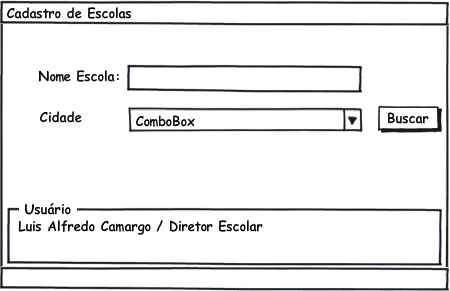
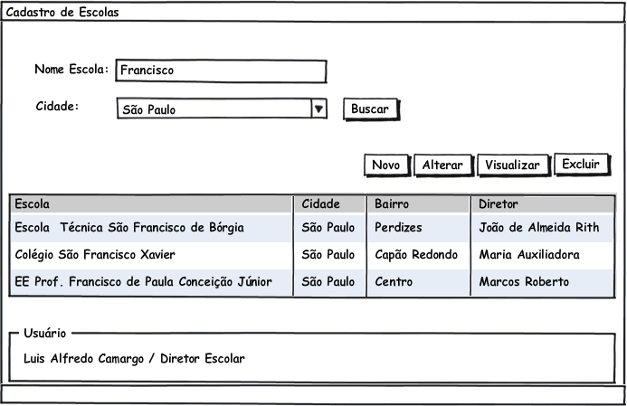

# Especificação de Caso de Uso

**\[NOME PROJETO\]**

**\[OPCIONAL\]**

**Histórico de Versões**

| **Data** | **Versão** | **Descrição** | **Autor** | **Revisor** |
| :-: | :-: | :-: | :-: | :-: |
| dd/mm/aa | x.y | Uma breve descrição da versão em questão | Nome do Primeiro autor | Nom dos possíveis revisores da versão |
|  |  |  |  |  |
|  |  |  |  |  |
|  |  |  |  |  |
|  |  |  |  |  |
|  |  |  |  |  |
|  |  |  |  |  |
|  |  |  |  |  |

| **Cliente** | FATEC  - Interno |
| -: | - |
| **Documento** | Especificação de Caso de Uso: *Manter Cadastro de Escolas* |
| **Data** | 01 de maio de 2010 |
| **Autor(es)** | **Rodrigo Rocha Silva** rrochas@gmail.com |

**Página de Assinaturas**

| Revisado e Aprovado por: |  |  |
| - | - | :-: |
|  |  | dd.mm.aa |
| Revisado e Aprovado por: |  |  |
|  |  | dd.mm.aa |
| Revisado e Aprovado por: |  |  |
|  |  | dd.mm.aa |
| Revisado e Aprovado por: |  |  |
|  |  | dd.mm.aa |
| Revisado e Aprovado por: |  |  |
|  |  | dd.mm.aa |

**Histórico de Versões**

| **Data** | **Versão** | **Descrição** | **Autor** | **Revisor** |
| :-: | :-: | :-: | :-: | :-: |
| dd/mm/aa | x.y | Uma breve descrição da versão em questão | Nome do Primeiro autor | Nome dos possíveis revisores da versão |
|  |  |  |  |  |
|  |  |  |  |  |
|  |  |  |  |  |
|  |  |  |  |  |
|  |  |  |  |  |
|  |  |  |  |  |
|  |  |  |  |  |

**Índice**

- [1. Nome do Caso de Uso](#1-nome-do-caso-de-uso)
- [2. Objetivo](#2-objetivo)
- [3. Descrição](#3-descrição)
- [4. Requisitos Funcionais](#4-requisitos-funcionais)
- [5. Tipo de Caso de Uso](#5-tipo-de-caso-de-uso)
- [6. Atores](#6-atores)
- [7. Pré-condições](#7-pré-condições)
- [7.1. Permissão de Usuário](#71-permissão-de-usuário)
- [8. Fluxo Principal](#8-fluxo-principal)
- [9. Fluxos Alternativos](#9-fluxos-alternativos)
- [10. Fluxos de Exceção](#10-fluxos-de-exceção)
- [11. Protótipos de Tela](#11-protótipos-de-tela)
- [11.1. Protótipo da Tela de Busca](#111-protótipo-da-tela-de-busca)
- [11.2. Protótipo da Tela de Resultado da Busca](#112-protótipo-da-tela-de-resultado-da-busca)
- [12. Pós-condições](#12-pós-condições)
- [12.1. Escola Cadastrada](#121-escola-cadastrada)
- [13. Requisitos Não-Funcionais](#13-requisitos-não-funcionais)
- [14. Ponto de Extensão](#14-ponto-de-extensão)
- 15. Critérios de Aceite
- 16. Observações
- 16.1. Prioridade de desenvolvimento
- 17. Referências

## 1. Nome do Caso de Uso

CDU01 – Manter Cadastro de Escolas

## 2. Objetivo

**\[Finalidade do caso de uso. Para tanto, será suficiente um único parágrafo.\]**

Este caso de uso tem como objetivo prover uma solução computacional capaz de persistir escolas na base de dados da secretária de educação, incluindo as funcionalidades de inserção (fluxo principal), visualização, alteração, exclusão e salvar como rascunho.

## 3. Descrição

**\[Descrição do caso de uso que possibilita uma visão geral da funcionalidade. Pode-se contar uma história para contextualizar o leitor, não ultrapassar três parágrafos\]**

Exemplo de uma descrição para um UC de manutenção de centros de custo de um hospital:

Através do cadastro de centros de custo é possível manter informações de centros de custo cadastrados no estabelecimento de saúde. Os centros de custo são setores do estabelecimento de saúde que possuem gastos mensuráveis.

A divisão de centros de custo não precisa obedecer a estrutura formal do estabelecimento de saúde, ou seja, não precisa seguir seu organograma. Para que se tenha uma visão de responsabilidade do ponto de vista organizacional, associa-se o centro de custos a uma unidade de negócio, que reproduz o organograma do estabelecimento.

No cadastro de centros de custo é possível informar seu código e nome e classificação, podendo ainda associá-lo a um grupo de centros de custo e a uma unidade de negócio.

É possível incluir, alterar, desativar, reativar e visualizar centros de custo existentes no cadastro de

centros de custo do estabelecimento de saúde.

## 4. Requisitos Funcionais

**\[Lista o identificador dos requisitos funcionais realizados por este casos de uso, auxiliando assim a rastreabilidade dos mesmo\]**

**RF01 – Cadatro de Escolas**

**RF02 – Validar dados Cadastrais**

## 5. Tipo de Caso de Uso

**\[Define o tipo do caso de uso\]**

| **X** | **Concreto** (Iniciado diretamente por um Ator) |
| - | - |
|  | **Abstrato** (Não iniciado diretamente por um Ator. Geralmente relacionado a outro Caso de Uso) |

## 6. Atores

**\[Lista os atores que interagem com o caso de uso definindo o tipo de cada um\]**

_(figura do documento original não convertida: diagrama de atores)_

## 7. Pré-condições

**\[A pré-condição de um caso de uso é o estado do sistema que deve estar presente antes de um caso de uso ser executado.\]**

### 7.1. Permissão de Usuário

O usuário deve estar autenticado no sistema e ter permissão para executar as operações.

## 8. Fluxo Principal

**P1. Iniciação**

**P1.1.** O sistema oferece uma interface de busca ao usuário, com os campos nome, cidade e bairro como parâmetros.

**P1.2.** O usuário solicita a busca com base nos parâmetros. O sistema irá limitar a quantidade de retorno conforme parâmetro definido pela Secretária de Educação (inicialmente 50).

**P1.3.** O sistema exibe uma lista de escolas e a cada registro retornado na busca: o nome, cidade, bairro e o nome do diretor(a)).

O usuário pode selecionar somente uma escola listada.

Após a consulta o sistema habilita a opção “Novo”, que permite ao usuário preencher um novo cadastro de escola, caso os registros retornados não o satisfaçam. O nome e bairro da escola utilizados na consulta serão recuperados no preenchimento de um novo cadastro e não poderão ser alterados.

No caso do usuário modificar os parâmetros da consulta, não será permitido ele inserir um Novo até que ele faça uma nova busca.

**P2. Preparar operação de manutenção**

Para a escola selecionada no passo anterior, é apresentado as opções abaixo.

a. Caso a opção escolhida seja Novo, segue P3.

b. Caso a opção escolhida seja Visualizar, segue A2 em seguida A1.

c. Caso a opção escolhida seja Editar, segue A2 e em seguida A3.

d. Caso a opção escolhida seja Excluir, segue A2 e em segue A4.

A opção “Novo” somente é habilitada quando foram preenchidos os campos nome e bairro do passo P1.2 e foi realizada a consulta.

**P3. Exibir campos de identificação da escola**

São exibidas ainda, em todas as telas do aplicativo, as informações sobre usuário autenticado que está realizando o cadastro.

**P4. Exibir campos de dados cadastrais**

**P4.1.** O sistema oferece os campos não - editáveis: Código da Escola, nome e bairro.

O nome e bairro vêm a partir da tela de consulta e não são editáveis. Também são apresentados os campos: CNPJ, registro MEC, telefone e email.

**P4.2.** O sistema oferece um conjunto de campos de endereço: logradouro, número, complemento e CEP. Os campos: estado, cidade e são preenchidos automaticamente. Caso não tenha número, o sistema preencherá automaticamente “s/n”.

**P4.3.** O sistema oferece um conjunto de campos para dados da direção: nome, CPF, telefone e email.

Todos os campos com exceção de complemento são considerados de preenchimento obrigatório.

**P5. Concluir Inserção da Escola**

O sistema exibe as opções:

a. Salvar definitivo,

b. Salvar rascunho.

Caso for escolhida a opção ‘a’, segue fluxo P6.

Caso for escolhida a opção ‘b’, vai para o passo A5.

**P6. Verificar escola**

O sistema verifica se todas as informações obrigatórias foram preenchidas.

Caso o procedimento de verificação retorne que não houve nenhum erro, segue P7. (**E01**)

**P7. Validar e confirmar escolas**

É instanciado o caso de uso **PE3 “Validar Cadastro de Escolas Online”**. O sistema exibe as mensagens de erros e alertas retornado pelo caso de uso.(**E02**).

Caso não haja erros ou haja alertas ou erros não impeditivos, continua passo P8.

**P8. Persistir dados sobre escola**

**P8.1.** O sistema persiste os dados Cadastrais da Escola. Caso for Novo, é gerado um novo Código da Escola e persistido juntamente com a Escola. É exibido ao usuário este código e exibe mensagem de operação efetuada com sucesso.

**P8.2.** Independente de o sistema ter inserido a nova escola ou ter alterado uma escola já cadastrada, o sistema altera/atribui o status da escola para ATIVA.

## 9. Fluxos Alternativos

**\[Pense nas subseções Fluxo Alternativo como um comportamento alternativo cada fluxo alternativo representa um comportamento alternativo geralmente devido a uma escolha do usuário ou processamento provocado por um estado diferente do esperado no Fluxo Principal.**

**Inicie cada fluxo alternativo com uma linha inicial determinando claramente onde o fluxo alternativo pode ocorrer e as condições em que ele é executado.**

**Encerre cada fluxo alternativo com uma linha que determina claramente para onde deve seguir o fluxo após a execução do mesmo**

**Utilizar fluxos alternativos aprimora a clareza do caso de uso. Tenha em mente que casos de uso são apenas descrições textuais e seu objetivo principal é documentar o comportamento de um sistema de uma maneira clara, concisa e compreensível.\]**

**A1. Visualizar Escola**

Este passo é executado a partir do passo P2 quando escolhida a opção ‘b’.

**A1.1.** O sistema invoca o sistema operacional para iniciar o programa vinculado ao arquivo, com extensão .pdf e exibe os dados retornados na consulta do passo anterior, exibindo-os em formato de relatório. Os campos são exibidos no modo “somente leitura”.

**A1.2.** Volta a P1.2.

**A2. Consultar escola Pontual**

Este passo é executado a partir do passo P2 quando escolhida a opção ‘a’, ‘b’ ou ‘c’.

**A2.1** O sistema executa uma consulta pontual da escola selecionada no passo P1.3, trazendo todos os dados desta Escola. Segue para o fluxo determinado em P2.

**A3. Editar escola estrangeiro**

Este passo é executado a partir do passo P2 quando escolhida a opção ‘c’.

**A3.1.** Os dados cadastrais são exibidos para edição.

**A3.2.** O sistema exibe os dados do elemento selecionado no passo P1.3, utilizando para isto os campos descritos no fluxo P3 e P4.

As verificações descritas nos passos P4 serão efetuadas novamente.

**A3.3.** O sistema permite as seguintes opções ao usuário:

a. Alterar,

a. Consultar;

Caso for escolhida a opção ‘a’, vai para o passo P7 (verificar).

Caso for escolhida a opção ‘b’, volta a P1.2.

**A4. Excluir Escola**

Este passo é executado a partir do passo P2 quando escolhida a opção ‘d’.

**A4.1.** O sistema pede confirmação do usuário para exclusão da escola escolhida. Caso o usuário não confirme, volta a P1.2. Caso o usuário confirme, segue o fluxo abaixo.

**A4.2.** A Escola é excluída logicamente da base.

**A4.4.** O sistema emite mensagem de transação efetuada com sucesso e volta a P1.2.

**A5. Salvar como rascunho dados da escola**

Este passo é executado a partir do passo P6 quando foi escolhida a opção para salvar como rascunho.

**A5.1.** É instanciado o caso de uso **PE3 “Validar Cadastro de Escolas Online”**.

**A5.2.** O sistema persiste na base de rascunhos os dados inseridos. É atribuído o status “***Rascunho***” aos dados da escola.

**A5.3.** Exibe ainda a mensagem de transação efetuada com sucesso e volta a P1.2.

## 10. Fluxos de Exceção

**\[cada fluxo exceção representa um comportamento de tratamento de problema geralmente devido às exceções que ocorrem no fluxo principal ou fluxo Alternativo. Pode-se em ter a extensão necessária para descrever os eventos associados ao comportamento de tratamento do problema\]**

**E1. Dados Obrigatórios não Preenchidos**

Caso retorne que houve erro, o sistema exibe os erros e vai para P4, habilitando os campos pertinentes com os dados digitados descritos em P4.

**E2. Erros impeditivos**

Caso haja mensagens de erros impeditivos, após o usuário visualizar os erros, é retornado ao passo P4.

## 11. Protótipos de Tela

**\[Apresentar os protótipos de tela para os fluxos descritos.\]**

### 11.1. Protótipo da Tela de Busca

Através da tela de pesquisa de escolas é possível verificar se uma escola já possui cadastro na

Secretária municipal.

### 11.2. Protótipo da Tela de Resultado da Busca

Nesta pesquisa o resultado é exibido em uma estrutura de tabela, onde para selecionar uma escola basta selecionar o registro desse.

Nos casos em que, dependendo da permissão de acesso do usuário autenticado, for possível incluir uma nova escola, alterar ou desativar um cadastro já existente, as opções para inclusão, alteração ou desativação

são exibidos acima da tabela com o resultado, sendo que os botões para alteração, desativação são

habilitados apenas quando um registro do resultado for selecionado e de acordo com a permissão de acesso

do usuário.

Quando não forem encontradas escolas que satisfaçam os critérios de pesquisa informados, é exibida uma mensagem na própria tela de pesquisa informando ao usuário que não foram encontradas escolas.

| **Elemento** | **Tipo** | **Status** | **Tam** | **Comportamento** |
| :-: | :-: | :-: | :-: | :-: |
|  |  |  |  |  |
| **Nome da Escola** | **Alfanumérico** | **Obrigatório** | **45** | Realiza a pesquisa pelo nome da escola informada. |
| **Bairro** | **Combobox** | **Obrigatório** | **-** | Indica a cidade da escola a ser pesquisada. Assume os dos da tabela de bairros. |
| **Consultar** | **Botão** | **Default** | **-** | Corresponde ao fluxo P1.2. Permissão de Acesso: SCHOOL\_SEARCH |

## 12. Pós-condições

**\[Uma pós-condição de um caso de uso é uma lista de estados possíveis que o sistema pode estar imediatamente após um caso de uso ter sido concluído.\]**

### 12.1. Escola Cadastrada

O cadastro da escola terá sido cadastrada, alterado, excluída ou visualizada.

## 13. Requisitos Não-Funcionais

**\[Lista os RNF aplicáveis ao caso de uso em questão.\]**

## 14. Ponto de Extensão

**\[Definição do local do ponto de extensão no fluxos principal ou alternativo, normalmente apresenta-se um UC que tem relacionamento de extend ou include com o UC em questão.\]**

**PE. “Validar Cadastro de Escolas Online”**

O objetivo é executar o processo de validação no servidor da secretária da educação, passando como parâmetro a escola inserida/alterada e retornando as mensagens de erros/alertas ou se a escola foi validada.

## 15. Observações

**\[Observações que se julgar importante, ter uma seção descrevendo a prioridade é altamente recomendável para se ter um melhor planejamento de execução por parte da gerência\]**

### 15.1. Prioridade de desenvolvimento

- Alta

## 16. Referências

**\[Inclua, ou forneça referências a, informações adicionais requeridas para explicar o caso de uso. Isso pode incluir diagramas de visão geral, exemplos ou qualquer outra coisa que você imagine.\]**
