# Documento de Visão de Projeto

**ImoX**

**Histórico de Versões**

| **Data** | **Versão** | **Descrição** | **Autor** | **Revisor** |
| :-: | :-: | :-: | :-: | :-: |
| 05/03/11 | 1.0 | Modelagem e desenvolvimento | Alex | - |

| **Cliente** | FATEC  - Interno |
| -: | - |
| **Documento** | Documento de Visão de Projeto: *ImoX* |
| **Data** | 05 de março  de 2011 |
| **Autor** | **Alex Marcolongo** alexmarcolongo@gmail.com |

**Página de Assinaturas**

| Revisado e Aprovado por: |  |  |
| - | - | :-: |
|  |  | 27/11/10 |

**Índice**

- Camada de Apresentação
- Camada de Persistência
- Diagrama de caso de uso geral do sistema
- Escopo
- Objetivo
- Pacote Model
- Qualidade
- Realização dos Casos de Uso Significativos
- Representação Arquitetural
- Tamanho e Performance
- Visão de Dados
- Visão de Implementação

## 1. Objetivo

Este documento trata principalmente da documentação das necessidades de negócios, da justificativa do projeto, do entendimento atual das necessidades do cliente e descreve resumidamente o novo produto, serviço ou resultado que deve satisfazer esses requisitos.

Tem o objetivo de alinhar as expectativas dos interessados para formalizar o início do projeto. Apresentar uma visão arquitetural dos sistemas da linha **SISCAD**. O intuito é salientar diferentes aspectos deste produto, obtidos a partir de decisões arquiteturais realizadas no âmbito dos sistemas da linha **SISCAD**.

### 1.1. Escopo

O escopo deste documento trata do desenvolvimento de um módulo que atenda todas as necessidades de uma biblioteca abrangendo qualquer instituição de ensino, sendo que este módulo é uma parte de um sistema maior.

O escopo deste documento é documentar as partes significativas do ponto de vista da arquitetura do modelo de design, como sua divisão em subsistemas e pacotes. Além disso, mostra sua divisão em classes e utilitários de classe.

### 1.2. Referências

Listar documentos relacionados a este documento de visão. Podem ser tanto documentos que foram utilizados para confeccionar este documento ou fazem parte deste documento, como documentos que estendem este documento.

Para a construção deste documento foram utilizadas as seguintes referências:

- Reuniões informais entre o grupo xyz e Tour House.

- Documentos elaborados pela Tour House:

SISTEMA FRONT END - CRM 2.doc

Este documento influencia os seguintes documentos:

- Documento de Requisitos

- WBS

## 2. Necessidades de Negócio

Exemplo 1: Um sistema informatizado para controle de uma biblioteca é necessário para que a instituição que utilizar esta solução consiga ter total controle de todos os livros que a mesma possui. Com o sistema, também é possível controlar todos os empréstimos e devoluções que são efetuadas. Além de tais funcionalidades, o sistema também poderá auxiliar no controle de empréstimos que estão em atraso, para que não ocorram perdas de livros.

Exemplo 2: Um sistema informatizado que a partir dos dados armazenados referentes as operações realizadas pela biblioteca gere relatórios que serão utilizados para o controle interno da mesma e para fornecer informações aos administradores da instituição de ensino na qual está localizada.

## 3. Objetivo do Projeto

Exemplo 1: Desenvolver uma plataforma para soluções web capaz de:

- armazenar informações em uma base de dados

- utilizar o protocolo HTTP

- ser executado em qualquer navegador

Exemplo 2: Desenvolver uma solução para uma biblioteca, que possibilite:

- Controlar os livros presentes no acervo da biblioteca e entrada de novos livros.

- Gerenciamento das operações realizadas na biblioteca: empréstimo, devolução de livros

- Integração com o sistema utilizado pela instituição de ensino

Minimizando o tempo de atendimento dos alunos e professores que desejam emprestar algum livro do acervo e facilitando a produção de relatórios com base nos dados apresentados por tais operações.

## 4. Declaração Preliminar de Escopo

Esta seção descreve, em alto nível, o escopo do projeto. Os requisitos serão melhor detalhados nos documentos de Requisitos e Dicionário WBS.

### 4.1. Descrição

Descrição narrativa do produto do projeto.

### 4.2. Produtos a serem entregues

Os seguintes itens são considerados produtos do projeto, na sua etapa 1.

- Sistema do módulo da biblioteca , etapa 1, implementado de acordo com a especificação feita na fase de análise. (código objeto e código fonte).

- Documentos de especificação do sistema, concebido na fase de elaboração.

- Hospedagem do sistema em ambiente 24 x 7.

### 4.3. Requisitos

É importante salientar que o documento de visão estará sendo feito no momento de iniciação do projeto. No qual, ainda não se tem todo o detalhamento. Portanto, os requisitos devem descritos em alto nível e depois detalhados em outro documento, caso o projeto seja aprovado.

#### 4.3.1. Requisitos Funcionais

O sistema deve ser capaz de efetuar o cadastro, exclusão, alteração e consulta de livros do acervo da biblioteca.

O sistema deve ser capaz de efetuar o controle dos empréstimos.

O sistema deve ser capaz de fazer o controle de atraso na devolução de livros que foram emprestados a um aluno ou professor.

O sistema deve ser capaz de produzir uma listagem com os livros que são os mais emprestados.

O sistema deve ser capaz de produzir relatórios referentes as operações do sistema.

O sistema deve ser capaz de pedir novos livros para o acervo da biblioteca.

O sistema deve ser capaz de realizar a consulta a históricos.

#### 4.3.2. Requisitos Não Funcionais

Utilizar linguagem Java

Utilizar o banco de dados PostGreSQL

A arquitetura da solução obdecer o design pattern MVC.

O sistema deve rodar nos seguintes browsers:

- IE

- Google Chrome

- Firefox

- Cronograma de Marcos Sumariado

#### 4.3.3. Regras de Negócio

## 5. Premissas

As premissas são informações que consideramos verdadeiras ou reais, e que vão sendo elaboradas gradativamente no decorrer do processo de Planejamento. Elas são documentas inicialmente no documento de visão e serão usadas como entradas em outros processos mais à frente.

Premissas são coisas que o gerente de projeto toma como verdade para basear o seu planejamento. Uma premissa considerada, mas não documentada, pode ocasionar o insucesso do projeto.

- O projeto será orientado pelo professor Rodrigo Rocha.

## 6. Influência das Partes Interessadas

Os interessados no projeto podem influenciar fortemente os objetivos do projeto. Muitos deles têm forte influência negativa e podem jogar areia no seu projeto. Na fase de Iniciação é importante que você possa identificar quais são as forças que poderão contribuir com seu projeto e quais serão as negativas para que você possa identificar formas de neutralizá-las. Procure conversar com os stakeholders do projeto e obter detalhes mais específicos sobre os objetivos e resultados pretendidos. Nessa etapa, o objetivo é obter uma visão geral do projeto, ou seja, a definição — que deve conter informações suficientes para descrever tanto o projeto, seus requisitos e objetivos, quanto como saber o que deve ser feito para ser concluído com êxito. Resumindo quais são os fatores críticos de sucesso de seu projeto.

Exemplo 1:

- Rodinei Perassol Isquierdo: diretor da Houter e patrocinador do projeto. Interessado em minimizar o custo operacional de atendimento da Houter, assim como, acompanhar a tendência dos seus concorrentes.

- Pedro Mendes Junior: gerente de marketing da Houter e da Premium. Interessado em expandir os canais de comunicação com os clientes, assim como, fixar a marca de ambas as empresas como inovadoras no Vale do Paraíba em termos de tecnologia.

- Afonso Santos Filho: gerente da Premium. Interessado em expandir os canais de venda.

- Regina: responsável pelo sistema ERP de ambas as empresas. Interessada que a solução de e-Commerce seja integrada ao sistema interno atual para facilitar o fluxo das operações.

- ClickNow: empresa responsável pela especificação da navegabilidade, definição do design, definição do conteúdo, desenvolvimento do site estático e campanhas de marketing do e-Commerce.

## 7. Representação Arquitetural

Os sistemas serão desenvolvidos tendo como base a arquitetura ilustrada na Figura 1. Toda a arquitetura será baseada nos padrões de projetos tradicionais do GoF e também nos padrões J2EE sendo executados dentro de um Servidor de Aplicações.

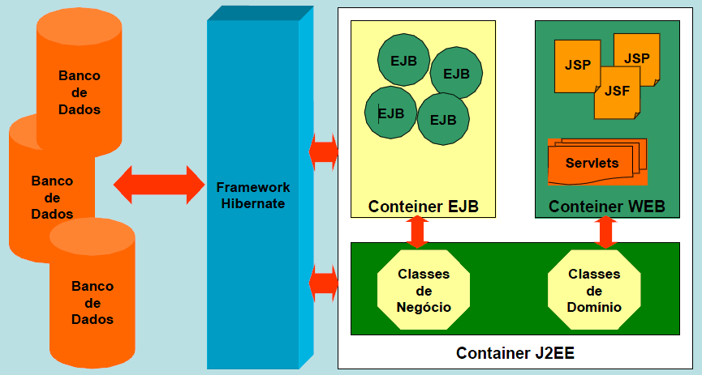

**Figura 1 - Modelo Arquitetural Genérico**

O Container WEB abrigará os componentes da arquitetura responsáveis pela camada de apresentação. Será utilizado para esta camada o FRAMEWORK JSF – Java Server Faces na implementação do modelo MVC.

As Classes de Domínio são as classes que representam os Value Object, contendo somente os atributos e os métodos getters/setters.

As Classes de Negócio representam as classes responsáveis por aplicar as regras de negócio do sistema como, por exemplo, Cadastrar Comarca. Constarão também nas classes de negócio o relacionamento com os DAOs responsáveis por persistir e recuperar os objetos no banco de dados.

No Container EJB constarão os componentes de software principais da arquitetura J2EE como Session Beans. Para esta arquitetura de software, será utilizado o padrão de projeto EJB COMMAND, reduzindo o número de componentes para a distribuição. O padrão EJB COMMAND será apresentado de forma mais detalhada na apresentação do Diagrama de classes da arquitetura mostrado na Figura 3. A arquitetura também dá suporte a aplicações somente J2SE, não sendo necessário o uso do servidor de aplicações para este caso.

O diagrama a seguir, Figura 2, representa a organização das classes dentro dos pacotes, tanto da arquitetura como da aplicação que fará uso da arquitetura. É importante atentar para a padronização de nomes de pacotes e a separação entre aplicação e arquitetura, bem como para o tipo de aplicação que se pretende desenvolver, J2SE ou J2EE.

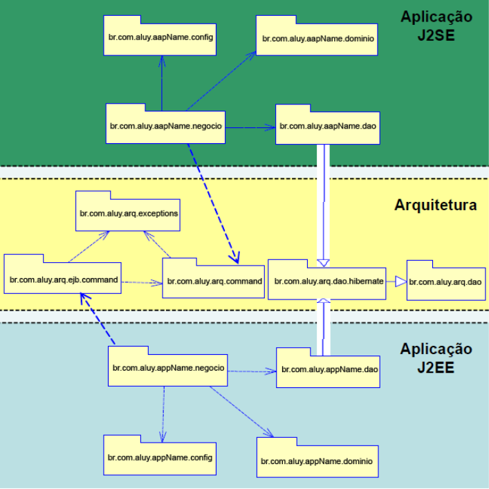

**Figura 2 - Diagrama em pacotes**

É importante ressaltar que o uso da arquitetura para aplicações J2SE não implica em importar para a aplicação o pacote ***br.com.aluy.arq.ejb.command***, mas o uso de uma aplicação J2EE implica em importar o pacote** *br.com.aluy.arq.command***, pois o padrão EJB-COMMAND usa o padrão COMMAND.

### 7.1. Restrições Arquiteturais

Foram identificadas algumas orientações / restrições pertinentes ao desenvolvimento deste subsistema:

- Utilização do JDK 1.4 do Java;

- Utilização do servidor Oracle Application Server ou TomCat 5.X;

- Utilização do framework Struts e da tecnologia Ajax para desenvolvimento da camada de apresentação;

- Utilização do framework Spring para desenvolvimento da camada de negócio e controle de transações;

- Utilização do framework de mapeamento objeto-relacional Hibernate;

- Utilização do SGBD Oracle.

### 7.2. Objetivos e Restrições Arquiteturais

Alguns requisitos registrados que impactam diretamente a arquitetura do sistema xxxx são:

- A consideração das bases de dados Sistemas Legados do MEC como fontes de dados de autenticação;

Considerando premissas definidas para os Sistemas XXXX pode-se citar as seguintes restrições:

- Utilização da Linguagem Java

- Considerar a utilização de software Livre, quando possível

- Necessidade de comunicação com sistemas legados do MEC

- O Sistema de Gerenciamento de Banco de Dados a ser considerado em implementações de âmbito corporativo será o SGBD Oracle.

## 8. Visão de Use Case

Esta seção apresenta os Casos de Uso arquiteturalmente significativos, que foram selecionados considerando-se o pacote do Modelo de Casos de Uso que representa o sistema xxxxx.

A classificação dos casos de uso, em termos de significância, foi realizada com base na observação de pelo menos um dos seguintes critérios:

- Casos de uso que estendem outros Casos de Uso

- Casos de Uso que são incluídos em outros Casos de Uso e

- Casos de uso que acessam sistemas externos

### 8.1. Diagrama de Caso de Manter Dados de Atributos

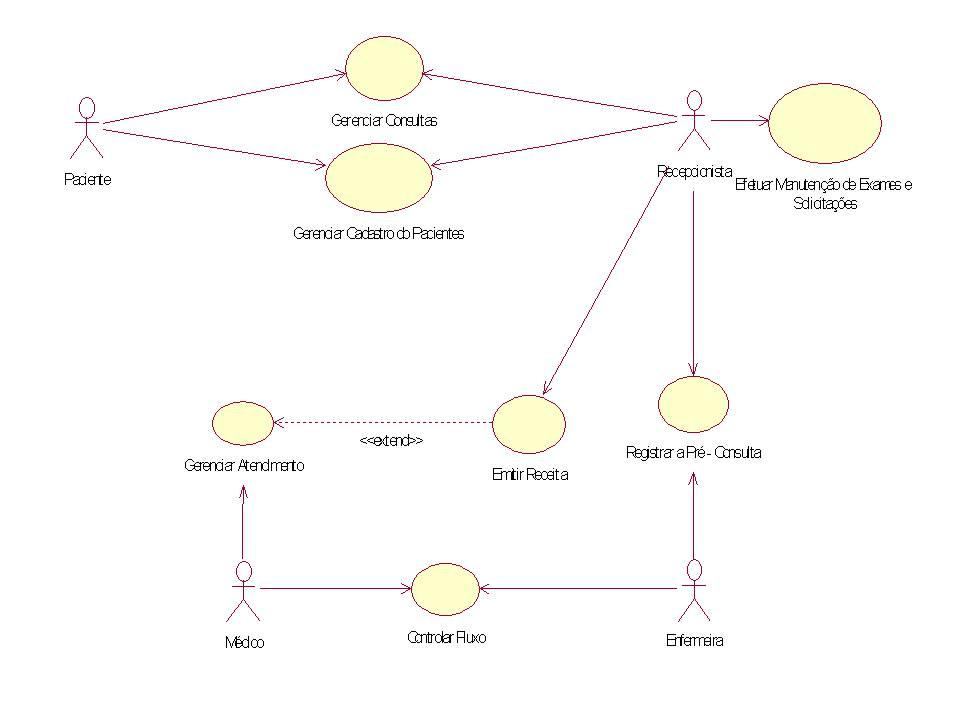

Figura 4.1 Diagrama de Caso de Uso de XXXXXXX

### 8.2. Descrição dos Casos de Uso Arquiteturalmente Significativos

**Manter Produtos**

Este caso de uso se inicia opcionalmente após a consulta de produtos por pat nunmber e o usuário solicita manutenção (incluir, alterar, excluir logicamente) nos dados de Atributos.

Descrição sucinta dos demais casos de uso (Pode ser o quadro resumo)

## 9. Visão de Lógica

Esta visão apresenta elementos de design significativos do ponto de vista da arquitetura, descrevendo a organização do Sistema XXXX em pacotes, bem como a organização desses pacotes em camadas.

O Diagrama com as camadas do sistema XXX é ilustrado na figura 5.1.

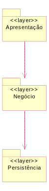

Figura 5.1 – Diagrama de camadas do XXXX

**Apresentação**: Contém classes para as interfaces gráficas com os usuários (GUI). Através destas interfaces os usuários conseguem interagir com o XXXX, com o intuito de incluir, alterar e excluir produtos.

**Negócio**: Contém classes que controlam a execução das funcionalidades do XXXX.

**Persistência**: Contém classes responsáveis por persistir as entidades de modelo. Por exemplo,

contém as classes que permitem ler e gravar os objetos no banco de dados relacional.

A Figura 5.2 ilustra o diagrama de camadas com as tecnologias utilizadas no desenvolvimento, já descritas na figura 5.1.

Neste momento, é importante ressaltar que a camada de apresentação envolve componentes que são executados na porção servidora e na porção cliente. Na porção servidora, são executados os componentes que montam as páginas html/jsp de resposta e controlam o fluxo de interação com o usuário. Assim, envolve interpretação de páginas jsp, utilização de helpers para montagem das páginas de resposta, delegação de solicitação para a camada de negócio, obtenção de respostas da camada de negócio, dentre outros. Já na porção cliente, estão os códigos javascript que são executados nos navegadores dos usuários com o intuito de facilitar a interação. Por exemplo, podem fazer uma pré-verificação dos dados digitados (como o preenchimento de campos obrigatórios), solicitação de páginas via ajax, de modo a tornar mais dinâmica a interação com o usuário, dentre outros.

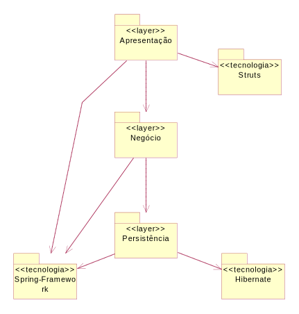

Figura 5.2: Camadas do xxx com as dependências de tecnologia

### 9.1. Camada de Apresentação

Nesta camada, temos o pacote form que contém todos os arquivos relacionados à exibição de informações para usuário, o que engloba páginas JSP e HTML, imagens, javascript, dentre outros. Já o pacote de controle desta camada, contém as Actions do Struts responsáveis pela comunicação com as classes da camada de negócio. Estes pacotes podem ser vistos na Figura 5.3.

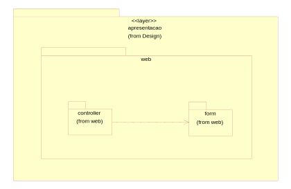

Figura 5.3: Camada de Apresentação

### Camada de Negócio

Nesta camada, temos o pacote controle que contém as classes responsáveis por controlar as regras de negócio da aplicação. O pacote model, contém as classes que representam o modelo, ou seja, aquelas que contém as informações sobre o Sistema XXX. O pacote controller contém as classes de controle do negócio. O pacote complementador contém classes que auxiliam na complementação de informações e o pacote filtro contém as classes que auxiliam na filtragem de informações.

A imagem 4.4 ilustra os pacotes descritos.

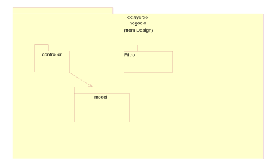

Figura 5.4: Camada de Negócios

#### 9.1.1. Pacote Controller

A figura 5.5 ilustra as principais classes de controle.

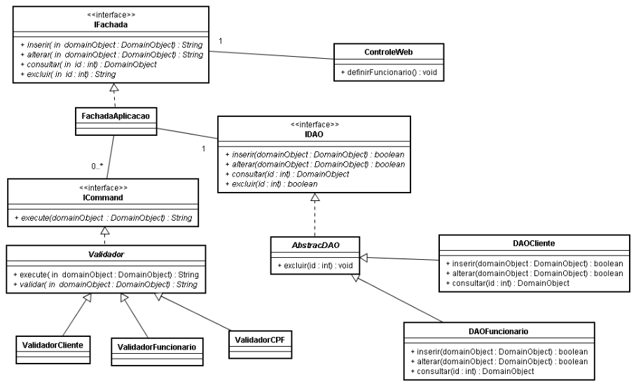

Figura 5.5: Classes de controle

#### 9.1.2. Pacote Model

A figura 5.6. ilustra as principais classes do modelo.

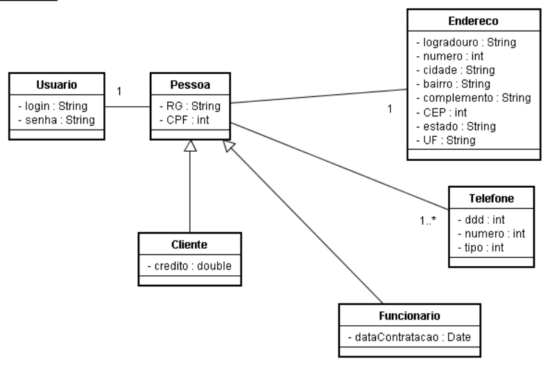

Figura 5.6: Classes do Modelo

### Camada de Persistência

Nesta camada temos o pacote dao que contém as classes e interfaces responsáveis por persistir as informações do XXXX no BD relacional. O pacote hibernate contido em dao, possui as classes que dependem diretamente do Hibernate, que é o framework utilizado para realizar o mapeamento objeto relacional.

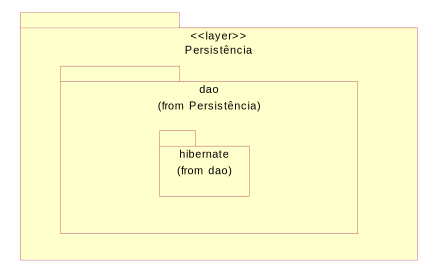

Figura 5.7: Camada de Persistência.

### Realização dos Casos de Uso Significativos

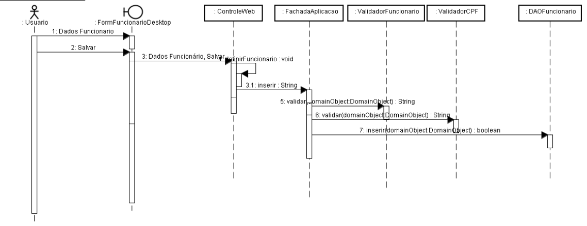

## 10. Visão de Implantação

Esta seção descreve as configurações da rede física (hardware) na qual o XXX será implantado e executado.

Trata-se de uma visão do Modelo de Implantação que, para a configuração em questão, indica os nós físicos (computadores, CPUs), que executarão o subsistema XXXX, e as respectivas interconexões (barramento, LAN, etc). A figura 6 ilustra o modelo de implantação para o XXXX.

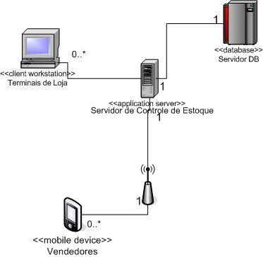

Figura 6: Visão de Implantação do XXXX

Na Figura 6 observa-se os seguintes nós físicos:

- **Web Client Application (WCA):** Aplicativos com interface de usuário via navegador, construídos com base no Framework Struts.

- **Servidor DB**: Nó que contém o BD Central do Sistema XXX.

Descrever demais elmentos

## 11. Visão de Implementação

Esta visão descreve a estrutura geral de implementação, a decomposição do software em camadas de implementação.

A estrutura geral de implementação para o SISCAD é baseada na estrutura da Visão Lógica, assim, não há necessidade de detalhar os diagramas de camadas e pacotes de implementação, uma vez que são fortemente baseados naqueles desenvolvidos para Visão Lógica.

## 12. Visão de Dados

O mecanismo de persistência utilizado no sistema SISCAD utiliza-se o banco de dados Relacional Oracle juntamente com o framework para mapeamento objeto-relacional, Hibernate. O controle de transações adotado envolve a utilização do Spring Framework em conjunto com o Hibernate.

As figuras XXX e YY, apresentam a visão lógica e física da base de dados do SISCAD.

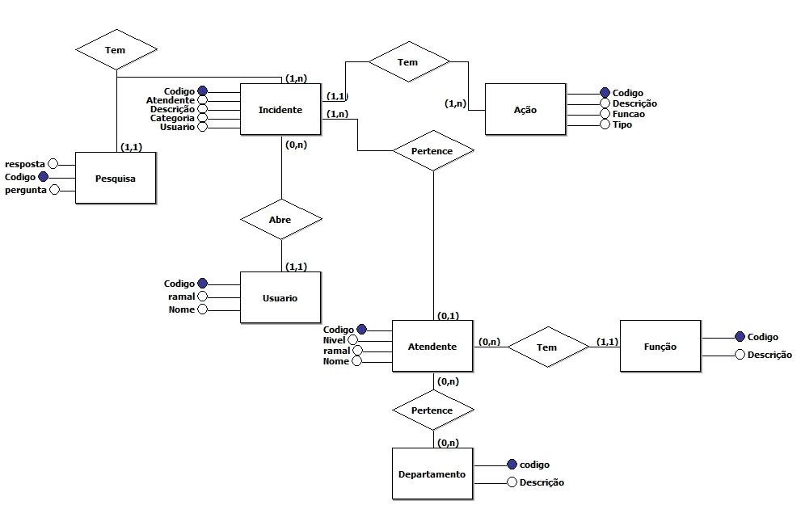

Figrua XXX – Modelo Lógico

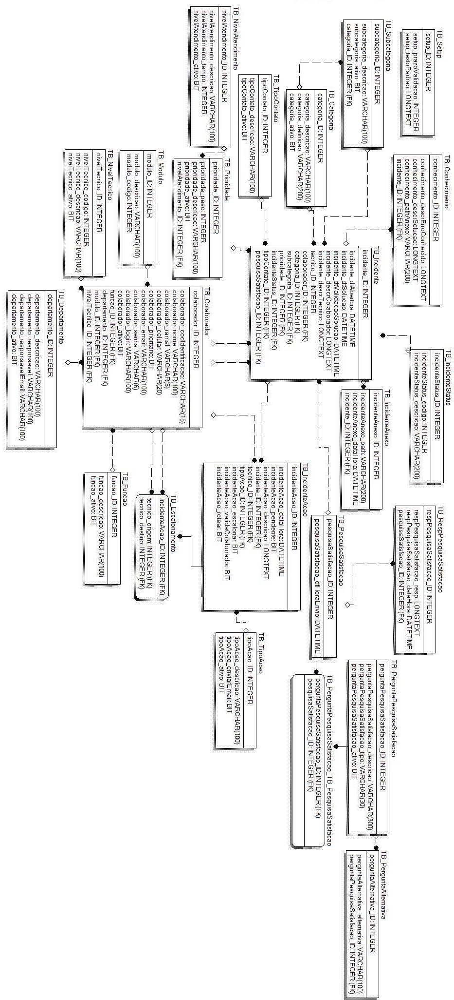

Figrua XXX – Modelo Físico

A Tabela 2 define o mapeamento das principais classes de modelo para entidades do modelo lógico do BD Oracle.

Note que existem alguns campos nas entidades lógicas do BD que não estão mapeadas diretamente com as classes de modelo da Visão Lógica contidas neste documento:

Os campos que começam com “IN” são campos definidos através de domínios do BD. As classes de modelo que possuem os atributos que representam tais campos não constam neste documento, mas podem ser consultadas no documento \[REF – Modelo de Design\].

Os campos \#NRSQ e DT REGISTRO presentes em todas as entidades lógicas do BD, correspondem a atributos presentes em superclasses das classes de modelo, que não constam neste documento, mas podem ser consultadas no documento \[REF – Modelo de Design\].

Tabela 2: Mapeamento Objeto-Relacional

| **Classe** | **Entidade** |
| :-: | :-: |
| **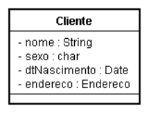** | 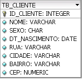 |
| **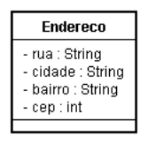** |  |

## 13. Tamanho e Performance

O sistema XXXX será usado para o controle do comércio exterior e conseqüentemente terá uma grande base.

Seus servidores provavelmente irão passar por períodos de picos de utilização (por exemplo, próximo a finalização de prazos de entrega de documentos e/ou procedimentos fiscais, tal como ocorre com os servidores que recebem declarações de imposto de renda).

As estimativas do número de usuários e de carga de utilização em períodos de pico de utilização, bem como maiores informações sobre questões relacionadas ao tamanho e desempenho do sistema XXX podem ser obtidas no documento de requisitos não funcionais.

## 14. Qualidade

O sistema XXX será usado para o controle do comércio exterior brasileiro, conseqüentemente tratando de altos volumes financeiros e um grande número de operações de importação/ exportação diariamente.

Eventuais erros e/ou falhas na sua operação podem levar a prejuízos significativos tanto em termos financeiros quanto na imagem da UMC, portanto na fase de design deve-se levar em consideração como fatores prioritários a confiabilidade e robustez do sistema.

Adicionalmente, o sistema XXX pode ser alvo de ataques de “hackers” para roubar ou simplesmente corromper informações, possibilidade aumentada pela interface do sistema disponível na Internet, para evitar que tais ataques sejam bem sucedidos uma infra-estrutura de segurança deve ser especificada e projetada.

Maiores informações sobre questões relacionadas aos requisitos de qualidade do sistema XXXX podem ser obtidas no documento de requisitos não funcionais.

## 15. Cronograma Macro.

Os prazos podem ser dados em semanas ou meses dentro do projeto ou ate mesmo data.

| **Resultado** |  |
| - | - |
| Plano Preliminar | Semana 2 |
| Plano Fase 1 | Semana 3 |
| Especificação Fase 1 | Semana 5 |
| Piloto Fase 1 | Semana 11 |
| Solução Testada Fase 1 | Semana 12 |
| Plano Fase 2 | Semana 13 |
| Especificação Fase 2 | Semana 14 |
| Piloto Fase 2 | Semana 20 |
| Solução Testada Fase 2 | Semana 21 |

Obs: Os prazos apresentados são uma estimativa inicial considerando as informações disponíveis nesta etapa do projeto. Um cronograma detalhado será elaborado na fase de planejamento e, eventualmente, estes prazos podem ser modificados.

## 16. Referências

Unified Modeling Language: [http://www.omg.org/technology/documents/formal/uml.htm](http://www.omg.org/technology/documents/formal/uml.htm)

RUP. Rational Unified Process.
